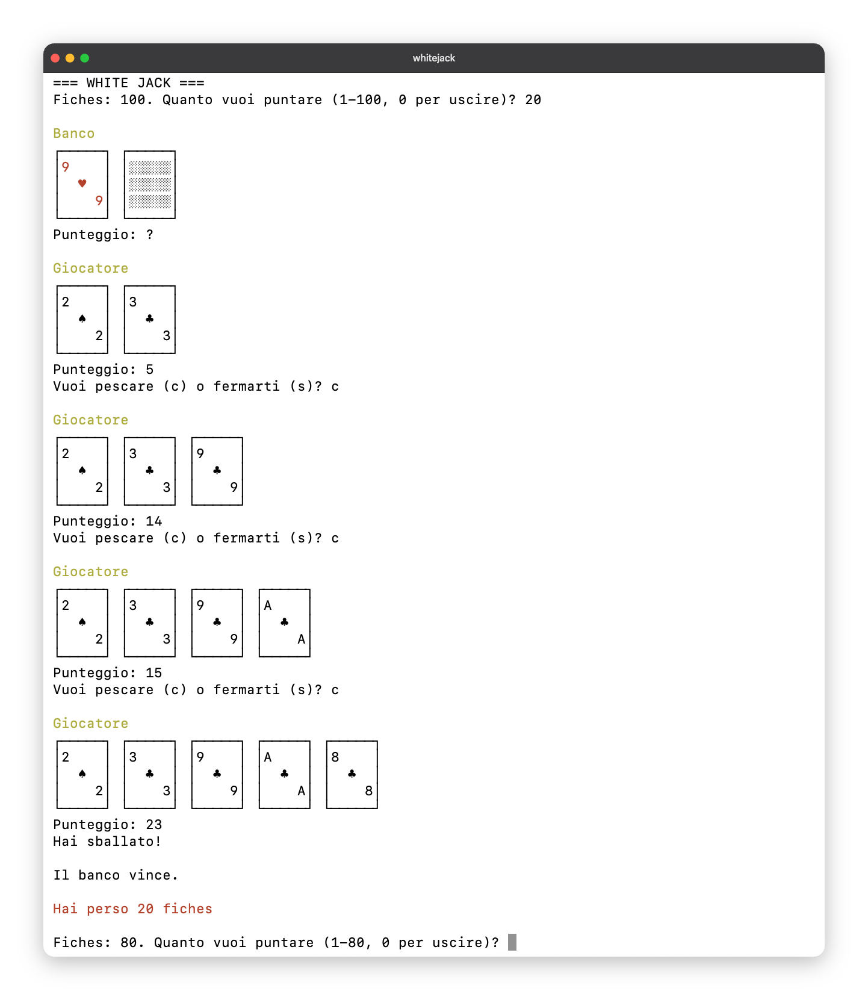

# White Jack
# Impara il C costruendo un blackjack da terminale



Guida pratica, passo dopo passo, per imparare il linguaggio C scrivendo un gioco di blackjack completo: mazzo, mescolata, punteggio, turno del giocatore e del banco, fiches e puntate, blackjack naturale, grafica ASCII a colori con la carta coperta. Si lavora solo con il **Terminale del Mac** e l'editor **`vi`**, senza programmi grafici.

Tutto il codice di questa guida è stato compilato e provato (compilatore `clang` con `-Wall -Wextra`, nessun avviso).

---

## Indice

0. [Cosa costruiamo e cosa imparerai](#0-cosa-costruiamo-e-cosa-imparerai)
1. [Concetti di base: compilatore, librerie, header](#1-concetti-di-base-compilatore-librerie-header)
2. [Preparare l'ambiente](#2-preparare-lambiente)
3. [L'editor vi](#3-leditor-vi)
4. [Lezione 1 - Il primo programma](#4-lezione-1---il-primo-programma)
5. [Lezione 2 - Le carte (enum, struct, funzioni)](#5-lezione-2---le-carte-enum-struct-funzioni)
6. [Lezione 3 - Il mazzo (array e cicli for)](#6-lezione-3---il-mazzo-array-e-cicli-for)
7. [Lezione 4 - Mescolare il mazzo (numeri casuali)](#7-lezione-4---mescolare-il-mazzo-numeri-casuali)
8. [Lezione 5 - La mano e il punteggio (puntatori)](#8-lezione-5---la-mano-e-il-punteggio-puntatori)
9. [Lezione 6 - Il turno del giocatore (input da tastiera)](#9-lezione-6---il-turno-del-giocatore-input-da-tastiera)
10. [Lezione 7 - Il banco e l'esito della partita](#10-lezione-7---il-banco-e-lesito-della-partita)
11. [Lezione 8 - Dividere il codice in moduli](#11-lezione-8---dividere-il-codice-in-moduli)
12. [Lezione 9 - Il Makefile](#12-lezione-9---il-makefile)
13. [Lezione 10 - Fiches, puntate e blackjack naturale](#13-lezione-10---fiches-puntate-e-blackjack-naturale)
14. [Lezione 11 - Grafica ASCII, colori e carta coperta](#14-lezione-11---grafica-ascii-colori-e-carta-coperta)
15. [Lezione 12 - Messaggi a colori e "Hai vinto/perso N fiches"](#15-lezione-12---messaggi-a-colori-e-hai-vintoperso-n-fiches)
16. [Codice completo finale](#16-codice-completo-finale)
17. [Errori comuni e come risolverli](#17-errori-comuni-e-come-risolverli)
18. [Glossario](#18-glossario)
19. [Esercizi e prossimi passi](#19-esercizi-e-prossimi-passi)

---

## 0. Cosa costruiamo e cosa imparerai

Alla fine avrai un gioco di blackjack giocabile da terminale, diviso in moduli come i programmi veri:

```
whitejack/
├── main.c        ← la partita: turni, puntate, risultato
├── carte.h/.c    ← carte, semi, mazzo, mescolata
├── mano.h/.c     ← mano, punteggio, blackjack naturale
├── grafica.h/.c  ← carte ASCII, colori, carta coperta
└── Makefile      ← compila tutto con il solo comando `make`
```

**Regole del gioco**
- Le carte da 2 a 10 valgono il loro numero. Fante, Donna e Re valgono 10.
- L'Asso vale 11, oppure 1 se con 11 si supererebbe 21.
- Chi supera 21 "sballa" e perde.
- Il banco pesca finché ha meno di 17 punti.
- Si parte con 100 fiches; a ogni mano si punta. Una vittoria paga 1 a 1, il blackjack naturale (21 con le prime due carte) paga 3 a 2.

**Cosa imparerai, lezione per lezione**

| Lezione | Argomenti del C e del terminale |
|---|---|
| 1 | `main`, `printf`, `#include`, compilare ed eseguire |
| 2 | `enum`, `struct`, funzioni, array di testi |
| 3 | array, ciclo `for`, cicli annidati |
| 4 | `rand`/`srand`, `#define`, funzioni con array |
| 5 | puntatori (`*`, `&`, `->`), `if`, `while` |
| 6 | `scanf`, `char`, `break`, `else if` |
| 7 | funzioni che si chiamano a vicenda, confronti |
| 8 | header, moduli, include guard, compilazione separata |
| 9 | Makefile, dipendenze, `make clean` |
| 10 | valori di ritorno, `&&`, `\|\|`, `while (1)`, input sicuro |
| 11 | codici ANSI, `switch`, `static`, disegno riga per riga |
| 12 | concatenazione di stringhe, variabili di appoggio |

**Convenzioni**
- I comandi da scrivere nel terminale sono nei blocchi ` ```bash `.
- I comandi da scrivere dentro `vi` sono nei blocchi ` ```text `; `Invio` significa il tasto Invio.
- Il testo da incollare nei file è nei blocchi ` ```c `, ` ```make `.
- In questa guida i comandi del terminale sono scritti **senza commenti** accanto, perché la `zsh` del Mac non li accetta per impostazione predefinita (vedi il capitolo 2).

---

## 1. Concetti di base: compilatore, librerie, header

### 1.1 Dal testo al programma

Un computer non esegue il testo che scrivi: lo devi **compilare**.

```
main.c  ──(compilatore)──►  main.o  ──(linker)──►  whitejack
sorgente                    file oggetto             programma eseguibile
```

- **Sorgente** (`.c`): il codice che scrivi tu.
- **File oggetto** (`.o`): il sorgente tradotto in linguaggio macchina, ma ancora "a pezzi".
- **Linker** (collegatore): unisce i file oggetto e le librerie in un unico **eseguibile**.

Il compilatore che usiamo è `clang`, già incluso negli strumenti di sviluppo del Mac.

### 1.2 Cos'è una libreria

Una **libreria** è codice già scritto da altri e raccolto in un pacchetto, che puoi riusare senza riscriverlo. Per esempio `printf` viene dalla libreria standard del C, e per leggere un file JSON puoi usare una libreria dedicata invece di scrivere il parser.

In C una libreria (o un "modulo") è fatta di due parti:

- **Header** (`.h`): l'*indice*. Elenca cosa offre il modulo: i tipi e le **dichiarazioni** delle funzioni (solo nome e parametri). Lo includi con `#include`.
- **Implementazione** (`.c`): contiene il codice vero delle funzioni.

Le due forme di `#include`:

- `#include <stdio.h>` con le parentesi angolari: header di sistema.
- `#include "carte.h"` con le virgolette: header scritto da te, nella tua cartella.

Nelle lezioni 8-11 trasformeremo il nostro gioco in piccole librerie di questo tipo.

### 1.3 Come è fatto un progetto C reale

Un progetto grande come **Redis** ha nella cartella `src/` centinaia di file con questi nomi:

| Estensione | Cos'è |
|---|---|
| `.c` e `.h` | sorgenti e header |
| `.o` | file oggetto generati dalla compilazione |
| `.d` | file di dipendenze, generati dal compilatore: servono a `make` per sapere cosa ricompilare quando cambia un header |
| `.dSYM/` | simboli di debug (specifici di macOS) |
| `Makefile` | le regole di compilazione |

Il nostro progetto avrà la stessa struttura, in piccolo. Quando avrai finito questa guida, leggere codice come quello di Redis sarà molto più semplice.

---

## 2. Preparare l'ambiente

### 2.1 Controllare il compilatore

Apri l'app **Terminale** e scrivi:

```bash
clang --version
```

Se compare una versione (per esempio `Apple clang version ...`), sei a posto. Se macOS chiede di installare gli "strumenti da riga di comando", accetta. In alternativa:

```bash
xcode-select --install
```

### 2.2 Comandi essenziali del terminale

| Comando | Cosa fa |
|---|---|
| `pwd` | mostra in quale cartella ti trovi |
| `ls` | elenca i file della cartella |
| `ls -a` | elenca anche i file nascosti (quelli che iniziano con un punto) |
| `ls -lrt` | elenco dettagliato, dal meno recente al più recente |
| `cd cartella` | entra in una cartella (`cd ..` per salire, `cd` da solo per tornare alla home) |
| `mkdir -p cartella` | crea una cartella (`-p`: nessun errore se esiste già) |
| `cat file` | stampa il contenuto di un file |
| `head -3 file` / `tail -3 file` | mostra le prime / ultime 3 righe |
| `cp origine destinazione` | copia un file |
| `touch file` | aggiorna la data di modifica di un file (lo crea se non esiste) |
| `grep -n "testo" file` | cerca un testo in un file e mostra i numeri di riga |
| `comando1 \| comando2` | passa l'output del primo comando al secondo (la "pipe") |
| `rm file` | **cancella** un file, subito e senza cestino. Usalo con attenzione |

### 2.3 Attenzione ai commenti `#` nel terminale

Nella `zsh` del Mac un `#` scritto accanto a un comando **non** viene trattato come commento, e dà errori come `zsh: bad pattern: #`. Quindi **non copiare i commenti** insieme ai comandi. Se vuoi poterlo fare, esegui una volta sola:

```bash
echo 'setopt interactive_comments' >> ~/.zshrc
source ~/.zshrc
```

Aggiunge un'impostazione al file di configurazione di zsh (`>>` aggiunge in fondo senza cancellare nulla) e la rende subito attiva.

### 2.4 Creare la cartella del progetto

```bash
mkdir -p ~/whitejack
cd ~/whitejack
pwd
```

Dovresti vedere qualcosa come `/Users/tuonome/whitejack`. Puoi usare anche un'altra posizione (per esempio dentro `Documents`): l'importante è lavorare sempre nella stessa cartella.

---

## 3. L'editor vi

`vi` (su Mac è in realtà `vim`) è l'editor presente su **ogni** sistema Unix e Linux, anche sui server. Ha una curva di apprendimento ripida, ma ripaga. L'alternativa più semplice è `nano` (vedi 3.5).

### 3.1 Le modalità

`vi` ha due modalità principali, ed è il punto in cui ci si perde:

- **Modalità normale** (quella di partenza): i tasti sono *comandi*, non scrivono testo.
- **Modalità inserimento**: i tasti scrivono testo. In basso compare `-- INSERT --`.

Si passa dalla normale all'inserimento con `i` (e simili), e si torna alla normale con **`Esc`**.

Se ti blocchi, premi `Esc` (anche due volte) e poi scrivi `:q!` e `Invio`: esce **senza salvare**.

### 3.2 Comandi essenziali

Tutti questi si scrivono in modalità normale, dopo `Esc`.

| Azione | Tasti |
|---|---|
| Aprire/creare un file | nel terminale: `vi nomefile` |
| Entrare in inserimento: prima / dopo il cursore | `i` / `a` |
| Nuova riga sotto / sopra e inserimento | `o` / `O` (maiuscola) |
| Fine riga e inserimento | `A` |
| Salvare | `:w` e `Invio` |
| Salvare ed uscire | `:wq` e `Invio` (oppure `ZZ`) |
| Uscire senza salvare | `:q!` e `Invio` |
| Spostarsi | frecce, oppure `h` `j` `k` `l` (sinistra, giù, su, destra) |
| Inizio / fine del file | `gg` / `G` |
| Cancellare un carattere / una riga | `x` / `dd` |
| Cancellare 3 righe | `3dd` |
| Cambiare una parola | `cw`, scrivi la nuova, `Esc` |
| Annullare / ripetere | `u` / `Ctrl+R` |
| Cercare | `/testo` e `Invio`; `n` per il successivo |
| Mostrare i numeri di riga | `:set number` e `Invio` |
| Svuotare tutto il file | `gg`, poi `dG` (oppure `ggdG`) |

### 3.3 Comandi con intervalli e sostituzioni

Servono nelle lezioni 8 e 12:

| Comando | Cosa fa |
|---|---|
| `:21,24d` | cancella le righe da 21 a 24 |
| `:/^int main/,$d` | cancella dalla riga che **inizia** con `int main` fino alla fine del file (`$`) |
| `:1;/^const char/-1d` | cancella dalla riga 1 fino alla riga **prima** di quella che inizia con `const char` |
| `:%s/vecchio/nuovo/` | sostituisce `vecchio` con `nuovo` in tutto il file |

In un comando di ricerca, `^` significa "inizio riga". Se compare l'errore `Pattern not found`, il testo cercato non c'è, oppure è scritto in modo diverso.

### 3.4 Incollare codice senza rovinarlo

1. Porta il cursore dove vuoi incollare.
2. Scrivi `:set paste` e `Invio`: vi non rovina più l'indentazione.
3. Entra in inserimento con `i`, `o` o `O`.
4. Incolla con **`Cmd+V`**.
5. Premi `Esc`, poi scrivi `:set nopaste` e `Invio`.

Due avvertenze importanti:

- **Incolla solo in modalità inserimento.** Con `Cmd+V` in modalità normale ogni carattere del testo viene eseguito come comando e il file si rovina. Se succede, premi `Esc` e poi `u` più volte per annullare.
- Il tasto `p` di vi **non** incolla dagli appunti del Mac: incolla solo ciò che hai copiato dentro vi con `yy` o `dd`.

### 3.5 I comandi non vanno scritti dentro il file

Se scrivi `:wq` mentre sei ancora in modalità inserimento, il testo `:wq` finisce **dentro il file** (per esempio in un commento). Prima premi sempre `Esc`.

### 3.6 File `.swp`: i file di scambio di vi

Mentre modifichi un file, vi crea una copia di lavoro nascosta, chiamata `.nomefile.swp` (per `main.c` è `.main.c.swp`). Serve a recuperare le modifiche se il computer si spegne. Con `:wq` vi la cancella da solo.

Se resta nella cartella, vuol dire che vi non è stato chiuso normalmente (finestra chiusa, `Ctrl+Z`, arresto improvviso). Controlla con `ls -a`. Se il nome è `.whitejack.swp`, non riguarda `main.c`: hai aperto l'**eseguibile** `whitejack` con vi. Un eseguibile non va mai modificato con vi.

Per eliminare lo swap, dopo aver controllato che non ci siano vi aperti da qualche parte (`jobs` mostra i programmi in pausa nel terminale corrente):

```bash
rm .whitejack.swp
```

Quando apri un file che ha uno swap rimasto, vi mostra **"Found a swap file"** con le scelte `(R)ecover`, `(D)elete`, `(Q)uit`. Se non sai cosa è successo, scegli `Q`.

### 3.7 nano e vimtutor

- **nano** ha una sola modalità: `nano main.c`, scrivi subito. Salva con `Ctrl+O` e `Invio`, esci con `Ctrl+X`. (Su Mac `Ctrl` è il tasto Control, non Cmd.)
- **vimtutor** è un tutorial interattivo di vi di circa 30 minuti, già installato. Scrivi `vimtutor` nel terminale. Vale la pena farlo.

---

## 4. Lezione 1 - Il primo programma

**Obiettivo:** scrivere, salvare, compilare ed eseguire un programma.

```bash
cd ~/whitejack
vi main.c
```

In vi premi `i` e scrivi:

```c
#include <stdio.h>                                              // include la libreria standard di input/output (serve per printf)

int main(void) {                                                // punto di partenza: il programma inizia sempre da main
    printf("Benvenuto a White Jack!\n");                        // stampa il testo a schermo; \n va a capo
    return 0;                                                   // termina il programma; 0 significa "tutto ok"
}                                                               // fine della funzione main
```

Poi `Esc`, `:wq` e `Invio`. Compila ed esegui:

```bash
clang -Wall -Wextra -o whitejack main.c
./whitejack
```

Dovresti leggere: `Benvenuto a White Jack!`

**Cosa significano i comandi**
- `clang`: il compilatore.
- `-Wall -Wextra`: attivano tutti gli avvisi. Sono utilissimi quando impari.
- `-o whitejack`: dà il nome `whitejack` al programma prodotto.
- `./whitejack`: esegue il programma. Il `./` significa "in questa cartella".

**Cosa significa il codice**

| Elemento | Significato |
|---|---|
| `#include <stdio.h>` | include l'header della libreria standard di input/output |
| `int main(void)` | la funzione da cui parte sempre il programma; `int` = restituisce un intero, `void` = non riceve argomenti |
| `printf("...")` | stampa del testo |
| `\n` | carattere speciale "a capo" |
| `return 0;` | termina il programma; `0` significa "tutto ok" |
| `;` | chiude ogni istruzione |
| `// ...` | commento: il compilatore lo ignora |

---

## 5. Lezione 2 - Le carte (enum, struct, funzioni)

**Obiettivo:** rappresentare una carta da gioco.

**Concetti nuovi**
- **`enum`**: una lista di nomi che dietro hanno numeri interi (0, 1, 2, ...). Serve per i semi.
- **`struct`**: un contenitore che raggruppa più dati. Una carta ha un valore e un seme.
- **funzione**: un blocco di codice con un nome, che puoi richiamare.

Apri il file, svuotalo (`Esc`, poi `ggdG`), premi `i` e scrivi o incolla:

```c
#include <stdio.h>                                              // libreria di input/output (printf)

enum Seme { CUORI, QUADRI, FIORI, PICCHE };                     // i 4 semi: valgono 0, 1, 2, 3

struct Carta {                                                  // una carta è composta da...
    int valore;                                                 // ...un valore (1 = asso, 11 = J, 12 = Q, 13 = K)
    enum Seme seme;                                             // ...e un seme
};                                                              // il ; dopo la struct è obbligatorio

const char *nomi_semi[] = { "Cuori", "Quadri", "Fiori", "Picche" };   // elenco di testi, nello stesso ordine dell'enum

void stampa_carta(struct Carta c) {                             // funzione che riceve una carta e non restituisce nulla (void)
    printf("%d di %s\n", c.valore, nomi_semi[c.seme]);          // %d = numero intero, %s = testo; c.valore legge un campo della carta
}                                                               // fine della funzione stampa_carta

int main(void) {                                                // il programma parte da qui
    struct Carta c = { 1, PICCHE };                             // crea una carta: valore 1, seme PICCHE
    stampa_carta(c);                                            // chiama la funzione per stamparla
    return 0;                                                   // fine, tutto ok
}                                                               // fine di main
```

Compila ed esegui. Dovresti vedere `1 di Picche`.

**Come funziona `nomi_semi[c.seme]`**: usa il seme come numero di posizione nell'elenco. `PICCHE` vale 3, quindi prende il quarto testo, "Picche" (si parte da 0). Per questo l'ordine dell'`enum` e quello dell'elenco devono coincidere.

**Esercizio:** cambia la carta in un Re di Cuori (`{ 13, CUORI }`), ricompila e riesegui: deve comparire `13 di Cuori`. In vi: sposta il cursore sulla parola, `cw`, scrivi il nuovo testo, `Esc`.

---

## 6. Lezione 3 - Il mazzo (array e cicli for)

**Obiettivo:** creare le 52 carte.

**Concetti nuovi**
- **array**: una fila di elementi dello stesso tipo, numerati da 0. `mazzo[52]` ha le posizioni da 0 a 51.
- **ciclo `for`**: ripete un blocco di codice più volte.

Sostituisci il contenuto del file (`Esc`, `ggdG`, `i`; se incollando l'indentazione si disallinea, usa prima `:set paste`) con:

```c
#include <stdio.h>                                              // libreria di input/output (printf)

enum Seme { CUORI, QUADRI, FIORI, PICCHE };                     // i 4 semi

struct Carta {                                                  // una carta...
    int valore;                                                 // ...ha un valore da 1 a 13
    enum Seme seme;                                             // ...e un seme
};                                                              // fine della struct

const char *nomi_semi[] = { "Cuori", "Quadri", "Fiori", "Picche" };   // testi dei semi, nell'ordine dell'enum

const char *nomi_valori[] = { "", "Asso", "2", "3", "4", "5", "6", "7",        // testi dei valori: la posizione 0 è vuota,
                              "8", "9", "10", "Fante", "Donna", "Re" };        // così il valore 1 corrisponde ad "Asso"

void stampa_carta(struct Carta c) {                             // stampa una carta
    printf("%s di %s\n", nomi_valori[c.valore], nomi_semi[c.seme]);   // es.: "Re di Cuori"
}                                                               // fine di stampa_carta

int main(void) {                                                // il programma parte da qui
    struct Carta mazzo[52];                                     // un array di 52 carte (posizioni da 0 a 51)
    int n = 0;                                                  // posizione della prossima carta da riempire

    for (int seme = CUORI; seme <= PICCHE; seme++) {            // ripete per ognuno dei 4 semi (0, 1, 2, 3)
        for (int valore = 1; valore <= 13; valore++) {          // e per ogni valore da 1 a 13
            mazzo[n].valore = valore;                           // scrive il valore nella carta numero n
            mazzo[n].seme = (enum Seme)seme;                    // scrive il seme (il cast converte il numero in enum)
            n++;                                                // passa alla posizione successiva
        }                                                       // fine del ciclo dei valori
    }                                                           // fine del ciclo dei semi

    for (int i = 0; i < 52; i++) {                              // per ogni posizione da 0 a 51...
        stampa_carta(mazzo[i]);                                 // ...stampa la carta
    }                                                           // fine del ciclo di stampa

    return 0;                                                   // fine, tutto ok
}                                                               // fine di main
```

```bash
clang -Wall -Wextra -o whitejack main.c
./whitejack
```

Deve comparire l'elenco delle 52 carte, da `Asso di Cuori` a `Re di Picche`. Per vedere solo l'inizio e la fine:

```bash
./whitejack | head -3
./whitejack | tail -3
```

**Come funziona:** il ciclo esterno passa i 4 semi, quello interno i 13 valori. `n` parte da 0 e aumenta di 1 a ogni carta: dopo 4 × 13 = 52 giri il mazzo è pieno.

---

## 7. Lezione 4 - Mescolare il mazzo (numeri casuali)

**Obiettivo:** mescolare le carte.

**Concetti nuovi**
- **Divisione in funzioni**: `crea_mazzo` e `mescola_mazzo`.
- **`rand()` e `srand()`**, dalla libreria `stdlib.h`, e **`time()`** da `time.h`.
- **`#define`**: una costante che il compilatore sostituisce nel codice.
- **Mescolata di Fisher-Yates**: parte dall'ultima carta e la scambia con una carta a caso tra quelle da 0 fino a lei, poi scende di una posizione. È il metodo standard per mescolare in modo equo.

Sostituisci il contenuto del file con:

```c
#include <stdio.h>                                              // input/output (printf)
#include <stdlib.h>                                             // numeri casuali: rand e srand
#include <time.h>                                               // l'orario attuale: time

#define NUM_CARTE 52                                            // costante: il compilatore sostituisce NUM_CARTE con 52

enum Seme { CUORI, QUADRI, FIORI, PICCHE };                     // i 4 semi

struct Carta {                                                  // una carta...
    int valore;                                                 // ...ha un valore da 1 a 13
    enum Seme seme;                                             // ...e un seme
};                                                              // fine della struct

const char *nomi_semi[] = { "Cuori", "Quadri", "Fiori", "Picche" };            // testi dei semi
const char *nomi_valori[] = { "", "Asso", "2", "3", "4", "5", "6", "7",        // testi dei valori (posizione 0 vuota)
                              "8", "9", "10", "Fante", "Donna", "Re" };        // il valore 1 corrisponde ad "Asso"

void stampa_carta(struct Carta c) {                             // stampa una carta
    printf("%s di %s\n", nomi_valori[c.valore], nomi_semi[c.seme]);   // es.: "Re di Cuori"
}                                                               // fine di stampa_carta

void crea_mazzo(struct Carta mazzo[]) {                         // riempie il mazzo con le 52 carte in ordine
    int n = 0;                                                  // posizione della prossima carta
    for (int seme = CUORI; seme <= PICCHE; seme++) {            // per ognuno dei 4 semi...
        for (int valore = 1; valore <= 13; valore++) {          // ...e per ogni valore da 1 a 13
            mazzo[n].valore = valore;                           // scrive il valore
            mazzo[n].seme = (enum Seme)seme;                    // scrive il seme
            n++;                                                // passa alla posizione successiva
        }                                                       // fine del ciclo dei valori
    }                                                           // fine del ciclo dei semi
}                                                               // fine di crea_mazzo

void mescola_mazzo(struct Carta mazzo[], int n) {               // mescola le prime n carte del mazzo
    for (int i = n - 1; i > 0; i--) {                           // parte dall'ultima carta e scende fino alla seconda
        int j = rand() % (i + 1);                               // sceglie una posizione casuale tra 0 e i
        struct Carta tmp = mazzo[i];                            // salva da parte la carta in posizione i
        mazzo[i] = mazzo[j];                                    // mette al suo posto la carta in posizione j
        mazzo[j] = tmp;                                         // mette la carta salvata in posizione j: le due carte si sono scambiate
    }                                                           // fine del ciclo
}                                                               // fine di mescola_mazzo

int main(void) {                                                // il programma parte da qui
    struct Carta mazzo[NUM_CARTE];                              // l'array di 52 carte

    srand((unsigned)time(NULL));                                // "semina" il generatore casuale con l'orario: ogni esecuzione è diversa
    crea_mazzo(mazzo);                                          // crea il mazzo in ordine
    mescola_mazzo(mazzo, NUM_CARTE);                            // lo mescola

    for (int i = 0; i < 5; i++) {                               // per le prime 5 posizioni...
        stampa_carta(mazzo[i]);                                 // ...stampa la carta
    }                                                           // fine del ciclo

    return 0;                                                   // fine, tutto ok
}                                                               // fine di main
```

Compila ed esegui più volte: le 5 carte devono cambiare a ogni esecuzione.

**Note**
- Quando passi `mazzo` a una funzione non ne viene fatta una copia: la funzione lavora sul mazzo vero, per questo `mescola_mazzo` lo cambia anche per `main`.
- `srand(time(NULL))` "semina" il generatore con l'orario. Senza questa riga, `rand()` produce sempre la stessa sequenza.

**Esercizio:** metti `//` davanti alla riga `srand(...)`, ricompila ed esegui due volte: vedrai le stesse 5 carte. Poi toglila.

---

## 8. Lezione 5 - La mano e il punteggio (puntatori)

**Obiettivo:** una mano di carte con il calcolo del punteggio.

**Regole:** 2-10 valgono il loro numero; Fante, Donna e Re valgono 10; l'Asso vale 11, oppure 1 se con 11 si sfora 21.

**Concetti nuovi**
- **`struct Mano`**: un array di carte e un contatore di quante ne contiene.
- **Puntatore (`*` e `&`)**: per far modificare una mano a una funzione le passi il suo **indirizzo** (`&giocatore`), non una copia. Dentro la funzione, `m->numero` significa "il campo `numero` della mano a cui punta `m`".
- **`if` e `while`**: scelte e cicli con condizione.

Sostituisci il contenuto del file con la versione completa a questo punto:

```c
#include <stdio.h>                                              // input/output (printf)
#include <stdlib.h>                                             // numeri casuali: rand e srand
#include <time.h>                                               // l'orario attuale: time

#define NUM_CARTE 52                                            // carte nel mazzo
#define MAX_MANO 12                                             // massimo di carte in una mano (con più di 11 si sfora 21 per forza)

enum Seme { CUORI, QUADRI, FIORI, PICCHE };                     // i 4 semi

struct Carta {                                                  // una carta...
    int valore;                                                 // ...ha un valore da 1 a 13
    enum Seme seme;                                             // ...e un seme
};                                                              // fine della struct Carta

struct Mano {                                                   // una mano è composta da...
    struct Carta carte[MAX_MANO];                               // ...un elenco di carte
    int numero;                                                 // ...e dal numero di carte che contiene adesso
};                                                              // fine della struct Mano

const char *nomi_semi[] = { "Cuori", "Quadri", "Fiori", "Picche" };            // testi dei semi
const char *nomi_valori[] = { "", "Asso", "2", "3", "4", "5", "6", "7",        // testi dei valori (posizione 0 vuota)
                              "8", "9", "10", "Fante", "Donna", "Re" };        // il valore 1 corrisponde ad "Asso"

void stampa_carta(struct Carta c) {                             // stampa una carta
    printf("%s di %s\n", nomi_valori[c.valore], nomi_semi[c.seme]);   // es.: "Re di Cuori"
}                                                               // fine di stampa_carta

void crea_mazzo(struct Carta mazzo[]) {                         // riempie il mazzo con le 52 carte in ordine
    int n = 0;                                                  // posizione della prossima carta
    for (int seme = CUORI; seme <= PICCHE; seme++) {            // per ognuno dei 4 semi...
        for (int valore = 1; valore <= 13; valore++) {          // ...e per ogni valore da 1 a 13
            mazzo[n].valore = valore;                           // scrive il valore
            mazzo[n].seme = (enum Seme)seme;                    // scrive il seme
            n++;                                                // passa alla posizione successiva
        }                                                       // fine del ciclo dei valori
    }                                                           // fine del ciclo dei semi
}                                                               // fine di crea_mazzo

void mescola_mazzo(struct Carta mazzo[], int n) {               // mescola le prime n carte del mazzo
    for (int i = n - 1; i > 0; i--) {                           // parte dall'ultima carta e scende
        int j = rand() % (i + 1);                               // sceglie una posizione casuale tra 0 e i
        struct Carta tmp = mazzo[i];                            // salva da parte la carta in posizione i
        mazzo[i] = mazzo[j];                                    // mette al suo posto la carta in posizione j
        mazzo[j] = tmp;                                         // mette la carta salvata in posizione j
    }                                                           // fine del ciclo
}                                                               // fine di mescola_mazzo

int valore_carta(struct Carta c) {                              // dice quanti punti vale una carta nel blackjack
    if (c.valore == 1) {                                        // se è un Asso...
        return 11;                                              // ...per ora lo contiamo 11
    }                                                           // fine del controllo
    if (c.valore >= 10) {                                       // se è 10, Fante, Donna o Re...
        return 10;                                              // ...vale 10
    }                                                           // fine del controllo
    return c.valore;                                            // altrimenti vale il suo numero
}                                                               // fine di valore_carta

int punteggio(struct Mano m) {                                  // calcola il punteggio di una mano
    int totale = 0;                                             // somma dei punti
    int assi = 0;                                               // quanti Assi ci sono nella mano
    for (int i = 0; i < m.numero; i++) {                        // per ogni carta della mano...
        totale += valore_carta(m.carte[i]);                     // ...aggiunge i suoi punti (+= significa "aggiungi a")
        if (m.carte[i].valore == 1) {                           // se la carta è un Asso...
            assi++;                                             // ...aumenta il conteggio degli Assi
        }                                                       // fine del controllo
    }                                                           // fine del ciclo
    while (totale > 21 && assi > 0) {                           // finché si sfora 21 e c'è un Asso contato 11...
        totale -= 10;                                           // ...lo trasforma in 1 (11 - 10)
        assi--;                                                 // ...e passa all'eventuale Asso successivo
    }                                                           // fine del ciclo
    return totale;                                              // restituisce il punteggio finale
}                                                               // fine di punteggio

void aggiungi_carta(struct Mano *m, struct Carta c) {           // aggiunge una carta alla mano (m è un puntatore: la mano originale)
    m->carte[m->numero] = c;                                    // mette la carta nella prima posizione libera (-> accede a un campo tramite puntatore)
    m->numero++;                                                // ora la mano ha una carta in più
}                                                               // fine di aggiungi_carta

void stampa_mano(struct Mano m) {                               // stampa tutte le carte della mano e il punteggio
    for (int i = 0; i < m.numero; i++) {                        // per ogni carta della mano...
        stampa_carta(m.carte[i]);                               // ...la stampa
    }                                                           // fine del ciclo
    printf("Punteggio: %d\n", punteggio(m));                    // stampa il punteggio
}                                                               // fine di stampa_mano

int main(void) {                                                // il programma parte da qui
    struct Carta mazzo[NUM_CARTE];                              // il mazzo di 52 carte
    int prossima = 0;                                           // posizione della prossima carta da pescare

    srand((unsigned)time(NULL));                                // seme casuale basato sull'orario
    crea_mazzo(mazzo);                                          // crea il mazzo in ordine
    mescola_mazzo(mazzo, NUM_CARTE);                            // lo mescola

    struct Mano giocatore;                                      // la mano del giocatore
    giocatore.numero = 0;                                       // all'inizio è vuota

    aggiungi_carta(&giocatore, mazzo[prossima]);                // pesca la prima carta (&giocatore = indirizzo della mano)
    prossima++;                                                 // la prossima carta da pescare è quella dopo
    aggiungi_carta(&giocatore, mazzo[prossima]);                // pesca la seconda carta
    prossima++;                                                 // avanza ancora

    printf("Mano del giocatore:\n");                            // titolo
    stampa_mano(giocatore);                                     // stampa le carte e il punteggio

    return 0;                                                   // fine, tutto ok
}                                                               // fine di main
```

Eseguilo qualche volta e controlla il punteggio: `Re` + `7` = 17, `Asso` + `Re` = 21.

**Come funziona il punteggio:** `punteggio` somma i valori contando ogni Asso come 11. Se il totale supera 21 e c'è almeno un Asso contato 11, lo trasforma in 1 (sottrae 10), una volta per ogni Asso, finché serve.

**Esercizio per vedere l'Asso in azione:** metti `//` davanti a `mescola_mazzo(...)`, così il mazzo resta in ordine (Asso, 2, 3, 4, 5 di Cuori). Duplica le due righe `aggiungi_carta` e `prossima++` per pescare 5 carte: il punteggio deve essere **15** (11 + 2 + 3 + 4 + 5 = 25, quindi l'Asso passa da 11 a 1). Con 4 carte è 20. Alla fine togli i `//`.

---

## 9. Lezione 6 - Il turno del giocatore (input da tastiera)

**Obiettivo:** il giocatore decide se pescare o fermarsi.

**Concetti nuovi:** `scanf` (legge da tastiera), `char` (un carattere), `break` (esce dal ciclo), `else if`, puntatore a `int` (`int *prossima`, con `(*prossima)++`).

### Dove mettere il codice

**1. Una funzione nuova, prima di `main`.** In vi: `Esc`, `/int main`, `Invio`, `O` (apre una riga sopra) e incolla:

```c
void turno_giocatore(struct Mano *giocatore, struct Carta mazzo[], int *prossima) {   // turno del giocatore: mano e posizione nel mazzo arrivano come puntatori, così la funzione può modificarle
    char scelta;                                                // qui memorizza la lettera digitata (char = un solo carattere)
    while (punteggio(*giocatore) < 21) {                        // finché il punteggio è sotto 21 (*giocatore = la mano a cui punta il puntatore)
        printf("Vuoi pescare (c) o fermarti (s)? ");            // chiede cosa fare
        if (scanf(" %c", &scelta) != 1) {                       // legge un carattere da tastiera (lo spazio prima di %c salta gli invii); se la lettura fallisce...
            break;                                              // ...esce dal ciclo
        }                                                       // fine del controllo
        if (scelta == 'c') {                                    // se ha scritto "c" (i caratteri singoli vogliono gli apici '...')...
            aggiungi_carta(giocatore, mazzo[*prossima]);        // ...mette nella mano la carta in cima al mazzo (*prossima = la posizione attuale)
            (*prossima)++;                                      // la prossima carta da pescare è quella dopo (le parentesi sono necessarie)
            printf("Hai pescato: ");                            // annuncia la carta
            stampa_carta(giocatore->carte[giocatore->numero - 1]);   // stampa l'ultima carta aggiunta (posizione numero - 1)
            printf("Punteggio: %d\n", punteggio(*giocatore));   // mostra il nuovo punteggio
        } else if (scelta == 's') {                             // altrimenti, se ha scritto "s"...
            break;                                              // ...esce dal ciclo: il giocatore si ferma
        } else {                                                // in tutti gli altri casi...
            printf("Scelta non valida.\n");                     // ...avvisa e richiede la scelta
        }                                                       // fine della scelta
    }                                                           // fine del ciclo
    if (punteggio(*giocatore) > 21) {                           // a fine turno, se il punteggio supera 21...
        printf("Hai sballato!\n");                              // ...il giocatore ha perso
    }                                                           // fine del controllo
}                                                               // fine di turno_giocatore
```

**2. Due righe in `main`**, dopo `stampa_mano(giocatore);` e prima di `return 0;`:

```c
    turno_giocatore(&giocatore, mazzo, &prossima);              // fa giocare il giocatore (passa gli indirizzi di mano e posizione, così vengono aggiornati)

    printf("\nMano finale:\n");                                 // titolo (\n iniziale lascia una riga vuota)
    stampa_mano(giocatore);                                     // stampa la mano finale e il punteggio
```

Compila ed esegui. Alla domanda scrivi `c` + `Invio` per pescare o `s` + `Invio` per fermarti.

**Prove:** pesca fino a sballare (deve comparire `Hai sballato!`); scrivi una lettera sbagliata come `x` (deve comparire `Scelta non valida.`); fermati subito con `s`.

**Note sul codice**
- Lo spazio in `" %c"` fa saltare gli invii rimasti nell'input.
- I caratteri singoli si scrivono con gli apici (`'c'`), le stringhe con le virgolette (`"c"`).
- `(*prossima)++` ha bisogno delle parentesi: senza, si sposterebbe il puntatore invece di aumentare il numero.

---

## 10. Lezione 7 - Il banco e l'esito della partita

**Obiettivo:** il banco pesca fino a 17 e si confrontano i punteggi.

### Dove mettere il codice

**1. Due funzioni nuove, prima di `main`** (`/int main`, `Invio`, `O`):

```c
void turno_banco(struct Mano *banco, struct Carta mazzo[], int *prossima) {   // turno del banco: pesca da solo, senza chiedere nulla
    while (punteggio(*banco) < 17) {                            // finché ha meno di 17 punti...
        aggiungi_carta(banco, mazzo[*prossima]);                // ...pesca la carta in cima al mazzo
        (*prossima)++;                                          // avanza nel mazzo
    }                                                           // fine del ciclo: il banco si ferma a 17 o più
}                                                               // fine di turno_banco

void stampa_esito(int punti_giocatore, int punti_banco) {       // confronta i punteggi (qui arrivano due numeri normali, non puntatori)
    if (punti_banco > 21) {                                     // se il banco ha sballato...
        printf("Il banco sballa: hai vinto!\n");                // ...vince il giocatore
    } else if (punti_giocatore > punti_banco) {                 // altrimenti, se il giocatore ha più punti...
        printf("Hai vinto!\n");                                 // ...vince
    } else if (punti_giocatore < punti_banco) {                 // se ne ha meno...
        printf("Il banco vince.\n");                            // ...vince il banco
    } else {                                                    // se ne ha lo stesso numero...
        printf("Pareggio.\n");                                  // ...pareggio
    }                                                           // fine dei confronti
}                                                               // fine di stampa_esito
```

**2. Sostituisci `main`.** Cancella la vecchia `main` e metti questa, che dà due carte anche al banco, ne mostra una sola e alla fine fa giocare il banco:

```c
int main(void) {                                                // il programma parte da qui
    struct Carta mazzo[NUM_CARTE];                              // il mazzo di 52 carte
    int prossima = 0;                                           // posizione della prossima carta da pescare

    srand((unsigned)time(NULL));                                // seme casuale basato sull'orario
    crea_mazzo(mazzo);                                          // crea il mazzo in ordine
    mescola_mazzo(mazzo, NUM_CARTE);                            // lo mescola

    struct Mano giocatore;                                      // la mano del giocatore
    giocatore.numero = 0;                                       // all'inizio è vuota
    struct Mano banco;                                          // la mano del banco
    banco.numero = 0;                                           // all'inizio è vuota

    aggiungi_carta(&giocatore, mazzo[prossima]);                // pesca la prima carta (&giocatore = indirizzo della mano)
    prossima++;                                                 // la prossima carta da pescare è quella dopo
    aggiungi_carta(&giocatore, mazzo[prossima]);                // pesca la seconda carta
    prossima++;                                                 // avanza ancora

    aggiungi_carta(&banco, mazzo[prossima]);                    // prima carta del banco
    prossima++;                                                 // avanza nel mazzo
    aggiungi_carta(&banco, mazzo[prossima]);                    // seconda carta del banco
    prossima++;                                                 // avanza nel mazzo

    printf("Mano del giocatore:\n");                            // titolo
    stampa_mano(giocatore);                                     // stampa le carte e il punteggio
    printf("\nCarta scoperta del banco:\n");                    // titolo
    stampa_carta(banco.carte[0]);                               // mostra solo la prima carta, la seconda resta coperta (con . perché banco è una mano normale, non un puntatore)
    printf("\n");                                               // riga vuota

    turno_giocatore(&giocatore, mazzo, &prossima);              // fa giocare il giocatore (passa gli indirizzi di mano e posizione, così vengono aggiornati)

    printf("\nMano finale:\n");                                 // titolo (\n iniziale lascia una riga vuota)
    stampa_mano(giocatore);                                     // stampa la mano finale e il punteggio
    if (punteggio(giocatore) <= 21) {                           // se il giocatore non ha sballato...
        turno_banco(&banco, mazzo, &prossima);                  // ...gioca il banco
        printf("\nMano del banco:\n");                          // titolo
        stampa_mano(banco);                                     // mostra tutte le carte del banco e il punteggio
        stampa_esito(punteggio(giocatore), punteggio(banco));   // dice chi ha vinto
    } else {                                                    // altrimenti il giocatore ha sballato...
        printf("\nIl banco vince.\n");                          // ...vince il banco senza giocare
    }                                                           // fine del controllo

    return 0;                                                   // fine, tutto ok
}                                                               // fine di main
```

In vi, per cancellare la vecchia `main` fino alla fine del file: `/int main`, `Invio`, poi `:.,$d` e `Invio`; quindi `o` e incolla.

**Prove:** fermati subito con `s` (il banco deve pescare fino ad avere almeno 17); sballa di proposito (il banco non gioca e vince); gioca 5-6 mani e controlla che l'esito sia sempre coerente con i punteggi.

Una semplificazione che per ora lasciamo: un 21 con due carte conta come un normale 21, senza regole speciali (lo sistemiamo nella lezione 10).

---

## 11. Lezione 8 - Dividere il codice in moduli

**Obiettivo:** passare da un unico file a più file, come nei progetti veri.

**Perché:** un file da 170 righe si legge ancora, uno da 2000 no. Con i moduli ogni file ha un compito preciso, e quando ne cambi uno ricompili solo quello.

**Struttura**

| File | Contenuto |
|---|---|
| `carte.h` / `carte.c` | Carta, Seme, creare, mescolare e stampare il mazzo |
| `mano.h` / `mano.c` | Mano, punteggio, aggiungere carte, stampare la mano |
| `main.c` | I turni e la partita |

Gli header hanno le **include guard** (`#ifndef ... #define ... #endif`): evitano errori se lo stesso header viene incluso due volte.

### Passo 0 - copia di sicurezza

```bash
cp main.c main_backup.c
```

### Passo 1 - crea `carte.h`

```bash
vi carte.h
```

`:set paste`, `i`, incolla:

```c
#ifndef CARTE_H                                                 // include guard: se CARTE_H non esiste ancora...
#define CARTE_H                                                 // ...lo definisce, così il file viene letto una volta sola

#define NUM_CARTE 52                                            // carte nel mazzo

enum Seme { CUORI, QUADRI, FIORI, PICCHE };                     // i 4 semi

struct Carta {                                                  // una carta...
    int valore;                                                 // ...ha un valore da 1 a 13
    enum Seme seme;                                             // ...e un seme
};                                                              // fine della struct

void stampa_carta(struct Carta c);                              // dichiarazione: il corpo è in carte.c (qui solo nome e parametri)
void crea_mazzo(struct Carta mazzo[]);                          // dichiarazione di crea_mazzo
void mescola_mazzo(struct Carta mazzo[], int n);                // dichiarazione di mescola_mazzo

#endif                                                          // fine dell'include guard
```

`Esc`, `:set nopaste`, `:wq`.

### Passo 2 - crea `mano.h`

```bash
vi mano.h
```

`:set paste`, `i`, incolla:

```c
#ifndef MANO_H                                                  // include guard
#define MANO_H                                                  // definisce MANO_H

#include "carte.h"                                              // la mano contiene carte, quindi serve il tipo Carta

#define MAX_MANO 12                                             // massimo di carte in una mano

struct Mano {                                                   // una mano è composta da...
    struct Carta carte[MAX_MANO];                               // ...un elenco di carte
    int numero;                                                 // ...e dal numero di carte che contiene
};                                                              // fine della struct

int valore_carta(struct Carta c);                               // dichiarazione: punti di una carta
int punteggio(struct Mano m);                                   // dichiarazione: punteggio di una mano
void aggiungi_carta(struct Mano *m, struct Carta c);            // dichiarazione: aggiunge una carta alla mano
void stampa_mano(struct Mano m);                                // dichiarazione: stampa mano e punteggio

#endif                                                          // fine dell'include guard
```

`Esc`, `:set nopaste`, `:wq`.

### Passo 3 - crea `carte.c` spostando il codice che c'è già

Non riscrivi nulla: copi `main_backup.c` e cancelli in vi ciò che non serve, usando intervalli.

```bash
cp main_backup.c carte.c
vi carte.c
```

In vi scrivi, uno alla volta, ognuno seguito da `Invio`:

```text
gg
:/^int valore_carta/,$d
:1;/^const char \*nomi_semi/-1d
:%s/^const char \*nomi/static const char *nomi/
```

- Il primo cancella da `int valore_carta` fino alla fine del file.
- Il secondo cancella dalla riga 1 fino alla riga prima di `const char *nomi_semi` (il `;` fa cercare dall'inizio, il `-1` toglie una riga).
- Il terzo aggiunge `static` davanti alle due tabelle: significa "visibili solo in questo file".

Restano le due tabelle dei nomi, `stampa_carta`, `crea_mazzo` e `mescola_mazzo`. Aggiungi le include in cima: `gg`, `:set paste`, `O`, e incolla:

```c
#include <stdio.h>                                              // printf (serve a stampa_carta)
#include <stdlib.h>                                             // rand (serve a mescola_mazzo)
#include "carte.h"                                              // tipi Carta e Seme e le dichiarazioni di queste funzioni

```

`Esc`, `:set nopaste`, `:wq`.

### Passo 4 - crea `mano.c`

```bash
cp main_backup.c mano.c
vi mano.c
```

```text
gg
:/^void turno_giocatore/,$d
:1;/^int valore_carta/-1d
```

Restano `valore_carta`, `punteggio`, `aggiungi_carta` e `stampa_mano`. In cima (`gg`, `:set paste`, `O`) incolla:

```c
#include <stdio.h>                                              // printf (serve a stampa_mano)
#include "mano.h"                                               // tipi Mano e Carta e le dichiarazioni di queste funzioni

```

`Esc`, `:set nopaste`, `:wq`.

### Passo 5 - riduci `main.c`

```bash
vi main.c
```

```text
gg
:1;/^void turno_giocatore/-1d
```

Restano `turno_giocatore`, `turno_banco`, `stampa_esito` e `main`. In cima (`gg`, `:set paste`, `O`) incolla:

```c
#include <stdio.h>                                              // printf e scanf
#include <stdlib.h>                                             // srand
#include <time.h>                                               // time
#include "carte.h"                                              // Carta, mazzo, NUM_CARTE
#include "mano.h"                                               // Mano, punteggio, aggiungi_carta

```

`Esc`, `:set nopaste`, `:wq`.

### Passo 6 - controlla e compila

Controlla che ogni funzione sia nel file giusto:

```bash
grep -n "^[a-z].*(.*{" carte.c mano.c main.c
```

Dovresti vedere:
- `carte.c`: `stampa_carta`, `crea_mazzo`, `mescola_mazzo`
- `mano.c`: `valore_carta`, `punteggio`, `aggiungi_carta`, `stampa_mano`
- `main.c`: `turno_giocatore`, `turno_banco`, `stampa_esito`, `main`

Compila tutto insieme:

```bash
clang -Wall -Wextra -o whitejack main.c carte.c mano.c
./whitejack
```

Per vedere cosa succede in due fasi, come in Redis:

```bash
clang -Wall -Wextra -c carte.c
clang -Wall -Wextra -c mano.c
clang -Wall -Wextra -c main.c
clang -o whitejack main.o carte.o mano.o
ls
```

`-c` compila senza collegare e produce un `.o`. L'ultimo comando è il **linker**, che unisce i file oggetto nel programma finale.

Se qualcosa si rovina, `main_backup.c` contiene ancora il programma intero (ma attenzione: non compilare mai con `clang *.c`, perché le funzioni risulterebbero duplicate).

---

## 12. Lezione 9 - Il Makefile

**Obiettivo:** compilare tutto con un solo comando, ricompilando solo ciò che è cambiato.

Un **Makefile** è un file di regole che dice a `make` come costruire il programma. Ogni regola ha questa forma:

```text
obiettivo: file-da-cui-dipende
<TAB>comando per costruirlo
```

`make` confronta le date dei file e ricompila **solo ciò che è cambiato**. Il file si chiama esattamente `Makefile`, con la M maiuscola.

```bash
vi Makefile
```

`:set paste`, `i`, incolla (in un Makefile i commenti con `#` vanno su righe a parte):

```make
# Compilatore da usare
CC = clang

# Opzioni di compilazione: tutti gli avvisi attivi
CFLAGS = -Wall -Wextra

# Elenco dei file oggetto che compongono il programma
OBJ = main.o carte.o mano.o

# Obiettivo principale: il programma si costruisce unendo i file .o (il linker)
whitejack: $(OBJ)
	$(CC) -o whitejack $(OBJ)

# main.o dipende da main.c e dagli header che include: se uno cambia, viene ricompilato
main.o: main.c carte.h mano.h
	$(CC) $(CFLAGS) -c main.c

# carte.o dipende da carte.c e dal suo header
carte.o: carte.c carte.h
	$(CC) $(CFLAGS) -c carte.c

# mano.o dipende da mano.c e dagli header che usa
mano.o: mano.c mano.h carte.h
	$(CC) $(CFLAGS) -c mano.c

# Obiettivo di pulizia: cancella i file generati (-f: nessun errore se non esistono)
clean:
	rm -f $(OBJ) whitejack

# clean non è un file ma un comando
.PHONY: clean
```

`Esc`, `:set nopaste`, `:wq`.

> **Attenzione ai TAB.** Le righe dei comandi (`$(CC) ...` e `rm ...`) devono iniziare con un carattere **TAB**, non con spazi. Se incollando sono diventati spazi, `make` dà l'errore `missing separator`. In quel caso apri il file con vi e scrivi `:%s/^ \+/\t/` e `Invio`: sostituisce gli spazi iniziali con un TAB. Per controllare, usa `cat -et Makefile`: i TAB compaiono come `^I`.

### Usare make

```bash
make
./whitejack
```

La prima volta `make` esegue tre compilazioni e un collegamento. Poi prova questi esperimenti:

```bash
make
```

Risposta: `make: 'whitejack' is up to date.` Non è cambiato nulla, quindi non ricompila niente.

```bash
touch mano.c
make
```

`touch` aggiorna l'ora di modifica del file. Stavolta `make` ricompila **solo `mano.o`** e rifà il collegamento.

```bash
make clean
ls
```

`make clean` cancella i `.o` e il programma. Poi `make` ricostruisce tutto.

Anche Redis usa un Makefile: i suoi file `.d` servono proprio a tenere traccia delle dipendenze tra i file.

---

## 13. Lezione 10 - Fiches, puntate e blackjack naturale

**Obiettivo:** un vero gioco con saldo e puntate, su più mani di fila.

**Regole che aggiungiamo**
- Si parte con **100 fiches** (costante `FICHES_INIZIALI`, modificabile).
- A ogni mano si punta da 1 fino al proprio saldo. Scrivendo **0** si esce.
- Vittoria: si guadagna la puntata. Sconfitta: la si perde. Pareggio: non cambia nulla.
- **Blackjack naturale** (21 con le prime due carte): paga **3 a 2**, arrotondato per difetto.
- Si gioca finché si hanno fiches o si decide di uscire. A ogni mano si usa un mazzo nuovo e mescolato.

**Concetti nuovi:** funzioni che **restituiscono un valore** (`return`), gli operatori `&&` ("e") e `||` ("o"), `while (1)` con `return`/`continue`, la pulizia dell'input sbagliato.

Le modifiche riguardano tre file. Prima di incollare, in ogni file scrivi `:set paste`.

### Modifica 1 - `mano.h` (la dichiarazione)

```bash
vi mano.h
```

Cerca `/#endif`, `Invio`, `O` (apre una riga sopra), e incolla:

```c
int ha_blackjack(struct Mano m);                                // dichiarazione: vero se la mano è un blackjack naturale
```

### Modifica 2 - `mano.c` (la funzione)

```bash
vi mano.c
```

Premi `G` (va in fondo al file), `o`, e incolla:

```c

int ha_blackjack(struct Mano m) {                               // dice se la mano è un blackjack naturale: 21 con le prime due carte
    return m.numero == 2 && punteggio(m) == 21;                 // vero (1) se ci sono esattamente 2 carte E il punteggio è 21 (&& = "e")
}                                                               // fine di ha_blackjack
```

> **Errore frequente:** il corpo della funzione va in `mano.c`, **non** in `mano.h`. Se finisce nell'header, sia `main.c` sia `mano.c` lo includono e il collegamento fallisce con `duplicate symbol '_ha_blackjack'` (vedi il capitolo 17).

### Modifica 3 - `main.c` (sostituisci la fine del file)

Il vecchio `stampa_esito` e il vecchio `main` vengono sostituiti da codice nuovo. `turno_giocatore` e `turno_banco` restano.

```bash
cp main.c main_prima_fiches.c
vi main.c
```

Dentro vi:

```text
gg
:/^void stampa_esito/,$d
```

Poi premi `G`, `o`, e incolla tutto questo blocco:

```c
#define FICHES_INIZIALI 100                                     // fiches con cui si comincia

void pesca_carta(struct Mano *m, struct Carta mazzo[], int *prossima) {   // prende la carta in cima al mazzo e la mette nella mano
    aggiungi_carta(m, mazzo[*prossima]);                        // aggiunge la carta alla mano
    (*prossima)++;                                              // avanza nel mazzo
}                                                               // fine di pesca_carta

int leggi_puntata(int saldo) {                                  // chiede la puntata finché non è valida; restituisce 0 se il giocatore vuole uscire
    int puntata;                                                // qui memorizza il numero scritto
    while (1) {                                                 // ciclo infinito: se ne esce con return
        printf("Fiches: %d. Quanto vuoi puntare (1-%d, 0 per uscire)? ", saldo, saldo);   // domanda
        int letti = scanf("%d", &puntata);                      // legge un intero; restituisce quanti valori ha letto
        if (letti == EOF) {                                     // se l'input è finito (es. Ctrl+D)...
            return 0;                                           // ...esce come se avesse scelto 0
        }                                                       // fine del controllo
        if (letti != 1) {                                       // se non ha scritto un numero (es. una lettera)...
            int c;                                              // carattere letto
            while ((c = getchar()) != '\n' && c != EOF) {       // ...scarta il resto della riga, un carattere alla volta
            }                                                   // il ciclo non ha altro da fare
            printf("Scrivi un numero.\n");                      // avvisa
            continue;                                           // torna all'inizio del ciclo e richiede
        }                                                       // fine del controllo
        if (puntata >= 0 && puntata <= saldo) {                 // se la puntata è tra 0 e il saldo...
            return puntata;                                     // ...è valida: la restituisce
        }                                                       // fine del controllo
        printf("Puntata non valida.\n");                        // altrimenti avvisa e ricomincia
    }                                                           // fine del ciclo
}                                                               // fine di leggi_puntata

int gioca_mano(int puntata) {                                   // gioca una mano intera; restituisce di quante fiches cambia il saldo (+ vinte, - perse)
    struct Carta mazzo[NUM_CARTE];                              // il mazzo di questa mano
    int prossima = 0;                                           // posizione della prossima carta da pescare
    crea_mazzo(mazzo);                                          // crea il mazzo in ordine
    mescola_mazzo(mazzo, NUM_CARTE);                            // lo mescola

    struct Mano giocatore;                                      // la mano del giocatore
    struct Mano banco;                                          // la mano del banco
    giocatore.numero = 0;                                       // all'inizio è vuota
    banco.numero = 0;                                           // anche questa

    pesca_carta(&giocatore, mazzo, &prossima);                  // si distribuisce come al tavolo: giocatore...
    pesca_carta(&banco, mazzo, &prossima);                      // ...banco...
    pesca_carta(&giocatore, mazzo, &prossima);                  // ...giocatore...
    pesca_carta(&banco, mazzo, &prossima);                      // ...banco

    printf("\nMano del giocatore:\n");                          // titolo
    stampa_mano(giocatore);                                     // carte e punteggio del giocatore
    printf("\nCarta scoperta del banco:\n");                    // titolo
    stampa_carta(banco.carte[0]);                               // del banco si vede solo la prima carta
    printf("\n");                                               // riga vuota

    int bj_giocatore = ha_blackjack(giocatore);                 // 1 se il giocatore ha un blackjack naturale, altrimenti 0
    int bj_banco = ha_blackjack(banco);                         // lo stesso per il banco
    if (bj_giocatore || bj_banco) {                             // se almeno uno ha blackjack (|| = "o")...
        printf("Mano del banco:\n");                            // ...si scoprono subito le carte del banco
        stampa_mano(banco);                                     // le mostra
        if (bj_giocatore && bj_banco) {                         // se ce l'hanno entrambi...
            printf("Blackjack per entrambi: pareggio.\n");      // ...pareggio
            return 0;                                           // il saldo non cambia
        }                                                       // fine del controllo
        if (bj_giocatore) {                                     // se ce l'ha solo il giocatore...
            printf("BLACKJACK! Vinci 3 a 2.\n");                // ...vince con il pagamento maggiorato
            return puntata * 3 / 2;                             // puntata x 3 / 2 (divisione tra interi: arrotonda per difetto)
        }                                                       // fine del controllo
        printf("Il banco ha blackjack.\n");                     // altrimenti ce l'ha solo il banco
        return -puntata;                                        // il giocatore perde la puntata
    }                                                           // fine del controllo

    turno_giocatore(&giocatore, mazzo, &prossima);              // gioca il giocatore (pesca o si ferma)
    printf("\nMano finale:\n");                                 // titolo
    stampa_mano(giocatore);                                     // mostra la mano finale

    if (punteggio(giocatore) > 21) {                            // se il giocatore ha sballato...
        printf("\nIl banco vince.\n");                          // ...perde, senza che il banco giochi
        return -puntata;                                        // perde la puntata
    }                                                           // fine del controllo

    turno_banco(&banco, mazzo, &prossima);                      // gioca il banco (pesca fino a 17)
    printf("\nMano del banco:\n");                              // titolo
    stampa_mano(banco);                                         // mostra la mano del banco

    int p_giocatore = punteggio(giocatore);                     // punteggio finale del giocatore
    int p_banco = punteggio(banco);                             // punteggio finale del banco
    if (p_banco > 21) {                                         // se il banco ha sballato...
        printf("\nIl banco sballa: hai vinto!\n");              // ...vince il giocatore
        return puntata;                                         // guadagna la puntata
    }                                                           // fine del controllo
    if (p_giocatore > p_banco) {                                // se il giocatore ha più punti...
        printf("\nHai vinto!\n");                               // ...vince
        return puntata;                                         // guadagna la puntata
    }                                                           // fine del controllo
    if (p_giocatore < p_banco) {                                // se ne ha meno...
        printf("\nIl banco vince.\n");                          // ...perde
        return -puntata;                                        // perde la puntata
    }                                                           // fine del controllo
    printf("\nPareggio.\n");                                    // altrimenti i punteggi sono uguali
    return 0;                                                   // il saldo non cambia
}                                                               // fine di gioca_mano

int main(void) {                                                // il programma parte da qui
    int fiches = FICHES_INIZIALI;                               // il saldo del giocatore

    srand((unsigned)time(NULL));                                // seme casuale basato sull'orario (una volta sola, all'avvio)
    printf("=== WHITE JACK ===\n");                             // titolo

    while (fiches > 0) {                                        // finché ci sono fiches...
        int puntata = leggi_puntata(fiches);                    // ...chiede la puntata
        if (puntata == 0) {                                     // se il giocatore vuole uscire...
            break;                                              // ...esce dal ciclo
        }                                                       // fine del controllo
        fiches += gioca_mano(puntata);                          // gioca la mano e aggiorna il saldo con il risultato
        printf("\nFiches: %d\n\n", fiches);                     // mostra il nuovo saldo
    }                                                           // fine del ciclo

    if (fiches == 0) {                                          // se il saldo è finito...
        printf("Hai finito le fiches. Fine della partita.\n");  // ...game over
    } else {                                                    // altrimenti il giocatore è uscito di sua volontà
        printf("Esci con %d fiches. Alla prossima!\n", fiches); // saluto con il saldo finale
    }                                                           // fine del controllo
    return 0;                                                   // fine, tutto ok
}                                                               // fine di main
```

Poi `Esc`, `:set nopaste`, `:wq`.

### Compila e prova

```bash
make
./whitejack
```

`make` dovrebbe ricompilare `main.c` e `mano.c`, ma non `carte.c`: è il vantaggio del Makefile.

**Prove**
1. **Puntata non valida**: prova una lettera (`ciao`), un numero troppo alto, un numero negativo. Il programma deve richiedere senza bloccarsi.
2. **Il saldo cambia nel modo giusto**: punta 10; una vittoria porta a +10, una sconfitta a -10, un pareggio a 0.
3. **Uscita**: scrivi `0` alla puntata.
4. **Game over**: punta tutto più volte; se perdi tutto compare `Hai finito le fiches`.

Il blackjack naturale esce in circa una mano su 21. Per provarlo subito, in `gioca_mano` metti temporaneamente `//` davanti a `mescola_mazzo(mazzo, NUM_CARTE);` e subito sotto aggiungi:

```c
    struct Carta tmp = mazzo[2]; mazzo[2] = mazzo[12]; mazzo[12] = tmp;   // PROVA TEMPORANEA
```

Il giocatore riceve Asso di Cuori e Re di Cuori: con puntata 10 devi vedere `BLACKJACK! Vinci 3 a 2.` e il saldo salire di 15. Poi **togli la riga di prova e i `//`**, altrimenti il gioco avrà sempre le stesse carte.

> Le fiches **non vengono salvate** tra una partita e l'altra: vivono solo nella variabile `fiches` in memoria, e a ogni avvio si riparte da 100. Salvarle in un file è uno degli esercizi proposti nel capitolo 19.

---

## 14. Lezione 11 - Grafica ASCII, colori e carta coperta

**Obiettivo:** disegnare le carte con bordo e simboli, in colore, e coprire la seconda carta del banco.

**Concetti nuovi**
- **Codici ANSI per i colori**: sequenze come `\033[31m` (da qui in rosso) e `\033[0m` (torna normale). Il terminale le interpreta come comandi.
- **Caratteri Unicode** (`┌ ─ │ ♥ ♦ ♣ ♠ ░`): sono semplici caratteri dentro le stringhe.
- **`switch`**: sceglie tra più casi, come tanti `if` in fila. Ogni caso termina con `break`.
- **Disegno riga per riga**: il terminale scrive dall'alto in basso, quindi per affiancare le carte si stampa la riga 0 di tutte le carte, poi la riga 1, e così via.
- **`static` sulle funzioni**: la funzione è visibile solo dentro il suo file.

Risultato (qui senza colori):

```text
Banco
┌─────┐ ┌─────┐
│3    │ │░░░░░│
│  ♦  │ │░░░░░│
│    3│ │░░░░░│
└─────┘ └─────┘
Punteggio: ?

Giocatore
┌─────┐ ┌─────┐
│3    │ │K    │
│  ♥  │ │  ♦  │
│    3│ │    K│
└─────┘ └─────┘
Punteggio: 13
```

### Passo 1 - crea `grafica.h`

```bash
vi grafica.h
```

`:set paste`, `i`, incolla:

```c
#ifndef GRAFICA_H                                               // include guard
#define GRAFICA_H                                               // definisce GRAFICA_H

#include "mano.h"                                               // serve il tipo Mano (che include a sua volta Carta)

#define ROSSO  "\033[31m"                                       // codice ANSI: da qui in poi il testo è rosso
#define VERDE  "\033[32m"                                       // codice ANSI: testo verde
#define GIALLO "\033[33m"                                       // codice ANSI: testo giallo
#define RESET  "\033[0m"                                        // codice ANSI: torna ai colori normali

void mostra_mano(const char *titolo, struct Mano m, int nascondi_seconda);   // disegna una mano; se nascondi_seconda è 1 la seconda carta resta coperta

#endif                                                          // fine dell'include guard
```

`Esc`, `:wq`.

### Passo 2 - crea `grafica.c`

```bash
vi grafica.c
```

`:set paste`, `i`, incolla:

```c
#include <stdio.h>                                              // printf
#include "grafica.h"                                            // dichiarazioni e colori di questo modulo

static const char *simboli[] = { "♥", "♦", "♣", "♠" };          // i simboli dei semi, nello stesso ordine dell'enum Seme
static const char *etichette[] = { "", "A", "2", "3", "4", "5", "6", "7",     // le scritte sull'angolo della carta (posizione 0 vuota)
                                   "8", "9", "10", "J", "Q", "K" };           // il valore 1 corrisponde ad "A" (Asso)

static const char *colore_seme(enum Seme s) {                   // restituisce il codice colore giusto per un seme (static: usata solo qui)
    if (s == CUORI || s == QUADRI) {                            // cuori e quadri...
        return ROSSO;                                           // ...sono rossi
    }                                                           // fine del controllo
    return RESET;                                               // fiori e picche restano del colore normale
}                                                               // fine di colore_seme

static void stampa_riga_carta(struct Carta c, int riga, int coperta) {   // stampa UNA riga (0-4) di UNA carta, senza andare a capo
    if (coperta) {                                              // se la carta è coperta...
        if (riga == 0) {                                        // ...la riga in alto...
            printf("┌─────┐");                                  // ...è il bordo superiore
        } else if (riga == 4) {                                 // ...la riga in basso...
            printf("└─────┘");                                  // ...è il bordo inferiore
        } else {                                                // ...le righe in mezzo...
            printf("│░░░░░│");                                  // ...sono il retro della carta
        }                                                       // fine delle righe della carta coperta
        return;                                                 // finito: esce dalla funzione
    }                                                           // fine del caso "coperta"
    const char *col = colore_seme(c.seme);                      // il colore di questa carta
    switch (riga) {                                             // sceglie cosa stampare in base al numero di riga
        case 0:                                                 // riga 0...
            printf("┌─────┐");                                  // ...bordo superiore
            break;                                              // break: esce dallo switch (senza, continuerebbe col caso dopo)
        case 1:                                                 // riga 1...
            printf("│%s%-2s%s   │", col, etichette[c.valore], RESET);   // ...valore in alto a sinistra (%-2s: allineato a sinistra su 2 spazi)
            break;                                              // fine del caso
        case 2:                                                 // riga 2...
            printf("│  %s%s%s  │", col, simboli[c.seme], RESET);        // ...simbolo del seme al centro
            break;                                              // fine del caso
        case 3:                                                 // riga 3...
            printf("│   %s%2s%s│", col, etichette[c.valore], RESET);    // ...valore in basso a destra (%2s: allineato a destra su 2 spazi)
            break;                                              // fine del caso
        default:                                                // qualsiasi altra riga (la 4)...
            printf("└─────┘");                                  // ...bordo inferiore
            break;                                              // fine del caso
    }                                                           // fine dello switch
}                                                               // fine di stampa_riga_carta

void mostra_mano(const char *titolo, struct Mano m, int nascondi_seconda) {   // disegna tutta la mano con le carte affiancate
    printf("\n%s%s%s\n", GIALLO, titolo, RESET);                // titolo in giallo (\n iniziale lascia una riga vuota)
    for (int riga = 0; riga < 5; riga++) {                      // ogni carta è alta 5 righe: le disegniamo riga per riga...
        for (int i = 0; i < m.numero; i++) {                    // ...e per ogni riga passiamo tutte le carte, così restano affiancate
            int coperta = (nascondi_seconda && i == 1);         // la carta è coperta solo se richiesto E se è la seconda (posizione 1)
            stampa_riga_carta(m.carte[i], riga, coperta);       // stampa la riga di questa carta
            printf(" ");                                        // uno spazio tra una carta e l'altra
        }                                                       // fine del ciclo delle carte
        printf("\n");                                           // a capo: finita questa riga di tutte le carte
    }                                                           // fine del ciclo delle righe
    if (nascondi_seconda) {                                     // se una carta è coperta...
        printf("Punteggio: ?\n");                               // ...il punteggio non si può sapere
    } else {                                                    // altrimenti...
        printf("Punteggio: %d\n", punteggio(m));                // ...mostra il punteggio vero
    }                                                           // fine del controllo
}                                                               // fine di mostra_mano
```

`Esc`, `:wq`.

### Passo 3 - modifica `main.c`

Sono sei piccole modifiche, da fare **in quest'ordine**. Apri `vi main.c`. Ogni ricerca va seguita da `Invio`. Prima di ogni cancellazione controlla che il cursore sia sulla riga giusta: se non lo è, premi `Esc` e non cancellare. Tieni `:set paste` attivo per tutta la sessione.

**3a. Include.** Scrivi `gg`, poi `/#include "mano.h"`, poi `o` (apre una riga sotto) e incolla:

```c
#include "grafica.h"                                          // mostra_mano e i colori
```

**3b. In `turno_giocatore`.** `Esc`, `/Hai pescato`, poi `3dd` (cancella le 3 righe: `printf("Hai pescato...`, `stampa_carta...`, `printf("Punteggio...`), poi `O` e incolla:

```c
            mostra_mano("Giocatore", *giocatore, 0);            // mostra la mano aggiornata (*giocatore perché qui la mano arriva come puntatore)
```

**3c. In `gioca_mano`, la mano iniziale.** `Esc`, `/Mano del giocatore:`, poi `5dd` (da `printf("\nMano del giocatore...` fino a `printf("\n");`), poi `O` e incolla:

```c
    mostra_mano("Banco", banco, 1);                             // mostra il banco con la seconda carta coperta (1 = nascondi)
    mostra_mano("Giocatore", giocatore, 0);                     // mostra il giocatore con tutte le carte scoperte (0 = non nascondere)
```

**3d. Nel ramo del blackjack.** `Esc`, `/Mano del banco` (trova la prima occorrenza: `printf("Mano del banco:\n");`), poi `2dd` (cancella quella riga e `stampa_mano(banco);`), poi `O` e incolla:

```c
        mostra_mano("Banco", banco, 0);                         // si scoprono subito le carte del banco
```

**3e. "Mano finale": qui basta cancellare.** La mano viene già mostrata a ogni pescata, quindi questa stampa sarebbe una ripetizione. `Esc`, `/Mano finale`, poi `2dd`. **Non** incollare niente.

**3f. Mano del banco a fine turno.** `Esc`, `/Mano del banco` (adesso trova l'ultima rimasta, `printf("\nMano del banco:\n");`), poi `2dd`, poi `O` e incolla:

```c
    mostra_mano("Banco", banco, 0);                             // mostra la mano completa del banco
```

`Esc`, `:set nopaste`, `:wq`.

> **Errore frequente in 3f:** incollare la riga senza aver prima fatto la ricerca e la cancellazione. La riga finisce subito dopo `turno_giocatore(...)` e scopre la carta coperta del banco **prima** che il giocatore abbia deciso, mentre le due righe vecchie restano più sotto.

Controlla di non aver dimenticato nulla:

```bash
grep -n "mostra_mano(" main.c
grep -n "stampa_mano\|Mano finale\|Mano del banco" main.c
```

Il primo comando deve mostrare **5 righe**, la più bassa subito dopo `turno_banco(...)`. Il secondo **nessuna**.

### Passo 4 - aggiorna il `Makefile`

```bash
vi Makefile
```

Scrivi questi due comandi (con `Invio` dopo ciascuno):

```text
:%s/^OBJ = main.o carte.o mano.o$/OBJ = main.o carte.o mano.o grafica.o/
:%s/^main.o: main.c carte.h mano.h$/main.o: main.c carte.h mano.h grafica.h/
```

Poi cerca `/# Obiettivo di pulizia`, premi `O`, e incolla la nuova regola. La riga col comando deve iniziare con un TAB:

```make
# grafica.o dipende da grafica.c e dagli header che usa
grafica.o: grafica.c grafica.h mano.h carte.h
	$(CC) $(CFLAGS) -c grafica.c

```

Se `make` dà `missing separator`, applica la correzione dei TAB descritta nella lezione 9. Poi `Esc`, `:set nopaste`, `:wq`.

### Passo 5 - compila e gioca

```bash
make
./whitejack
```

Controlla che i cuori e i quadri siano **rossi**, che la seconda carta del banco sia coperta (`░░░░░`) mentre decidi e che venga scoperta quando tocca al banco. Se i simboli o i bordi appaiono storti, il terminale non sta usando UTF-8.

**Esercizio:** in `grafica.c` cambia `"J", "Q", "K"` in `"F", "D", "R"` (Fante, Donna, Re).

---

## 15. Lezione 12 - Messaggi a colori e "Hai vinto/perso N fiches"

### 15.1 Messaggi a colori

I colori si usano anche nei messaggi di `main.c`: basta mettere il codice colore prima e dopo il testo. Due stringhe scritte una accanto all'altra vengono unite dal compilatore:

```c
printf(VERDE "\nHai vinto!\n" RESET);
```

Invece di cambiare le righe una per una, usa i comandi di sostituzione di vi:

```bash
vi main.c
```

Scrivi questi comandi uno alla volta, premendo `Invio` dopo ognuno (da modalità normale):

```text
:%s/printf("\\nHai vinto!\\n");/printf(VERDE "\\nHai vinto!\\n" RESET);/
:%s/printf("\\nIl banco sballa: hai vinto!\\n");/printf(VERDE "\\nIl banco sballa: hai vinto!\\n" RESET);/
:%s/printf("BLACKJACK! Vinci 3 a 2.\\n");/printf(VERDE "BLACKJACK! Vinci 3 a 2.\\n" RESET);/
:%s/printf("\\nIl banco vince.\\n");/printf(ROSSO "\\nIl banco vince.\\n" RESET);/
:%s/printf("Il banco ha blackjack.\\n");/printf(ROSSO "Il banco ha blackjack.\\n" RESET);/
:%s/printf("Hai sballato!\\n");/printf(ROSSO "Hai sballato!\\n" RESET);/
:%s/printf("\\nPareggio.\\n");/printf(GIALLO "\\nPareggio.\\n" RESET);/
:%s/printf("Blackjack per entrambi: pareggio.\\n");/printf(GIALLO "Blackjack per entrambi: pareggio.\\n" RESET);/
:wq
```

- `:%s/vecchio/nuovo/` cerca `vecchio` in tutto il file (`%`) e lo sostituisce con `nuovo`.
- Il doppio `\\` serve perché in vi il backslash va raddoppiato per scrivere un `\` vero. Nel codice resta `\n`.
- Dopo ogni comando vi dice quante sostituzioni ha fatto. Con `Il banco vince.` ne fa **due**, perché il messaggio compare in due punti.

Colori scelti: verde per le vittorie, rosso per le sconfitte, giallo per i pareggi. Puoi cambiarli o definirne altri in `grafica.h` (per esempio `\033[36m` è azzurro).

### 15.2 "Hai vinto N fiches" / "Hai perso N fiches"

A fine mano, invece di mostrare `Fiches: 50`, mostriamo quanto si è vinto o perso. Il saldo resta visibile nella domanda della mano successiva (`Fiches: 110. Quanto vuoi puntare...`).

Si modifica `main.c`, nella funzione `main`, nel ciclo `while (fiches > 0)`:

```bash
vi main.c
```

1. Scrivi `/fiches += gioca_mano`, `Invio`. Il cursore va sulla riga `fiches += gioca_mano(puntata);`.
2. Premi `2dd`: cancella quella riga e quella sotto, `printf("\nFiches: %d\n\n", fiches);`.
3. Scrivi `:set paste`, `Invio`, poi `O` (apre una riga sopra) e incolla:

```c
        int variazione = gioca_mano(puntata);                   // gioca la mano: restituisce quante fiches si vincono (+) o si perdono (-)
        fiches += variazione;                                   // aggiorna il saldo
        if (variazione > 0) {                                   // se è positiva...
            printf(VERDE "\nHai vinto %d fiches\n\n" RESET, variazione);       // ...hai vinto: mostra quante
        } else if (variazione < 0) {                            // se è negativa...
            printf(ROSSO "\nHai perso %d fiches\n\n" RESET, -variazione);      // ...hai perso: mostra quante (il meno davanti toglie il segno)
        } else {                                                // se è zero...
            printf(GIALLO "\nLa puntata ti torna indietro\n\n" RESET);          // ...nessun cambiamento
        }                                                       // fine dei controlli
```

4. `Esc`, `:set nopaste`, `:wq`.

Poi `make` e `./whitejack`.

**Come funziona**
- `gioca_mano` restituisce già la variazione del saldo (+10, -20, +15 per il blackjack, 0 per il pareggio). Ora la salviamo in una variabile, `variazione`, per usarla anche nel messaggio.
- Nella sconfitta la variazione è negativa (-50). Scrivendo `-variazione` si toglie il segno: il messaggio dice "Hai perso 50 fiches" e non "Hai perso -50 fiches".
- `%d` viene sostituito dal numero passato dopo la stringa. In `printf(VERDE "...%d..." RESET, variazione)` la variabile va **dopo** tutte le stringhe unite, e gli argomenti vanno nello stesso ordine dei `%d`.

---

## 16. Codice completo finale

Questi sono i file del progetto a fine guida, tutti compilati con `clang -Wall -Wextra` senza avvisi. Servono per controllare il tuo lavoro o per ripartire da una versione sicura.

### `carte.h`

```c
#ifndef CARTE_H                                                 // include guard: se CARTE_H non esiste ancora...
#define CARTE_H                                                 // ...lo definisce, così il file viene letto una volta sola

#define NUM_CARTE 52                                            // carte nel mazzo

enum Seme { CUORI, QUADRI, FIORI, PICCHE };                     // i 4 semi

struct Carta {                                                  // una carta...
    int valore;                                                 // ...ha un valore da 1 a 13
    enum Seme seme;                                             // ...e un seme
};                                                              // fine della struct

void stampa_carta(struct Carta c);                              // dichiarazione: il corpo è in carte.c (qui solo nome e parametri)
void crea_mazzo(struct Carta mazzo[]);                          // dichiarazione di crea_mazzo
void mescola_mazzo(struct Carta mazzo[], int n);                // dichiarazione di mescola_mazzo

#endif                                                          // fine dell'include guard
```

### `carte.c`

```c
#include <stdio.h>                                              // printf (serve a stampa_carta)
#include <stdlib.h>                                             // rand (serve a mescola_mazzo)
#include "carte.h"                                              // tipi Carta e Seme e le dichiarazioni di queste funzioni

static const char *nomi_semi[] = { "Cuori", "Quadri", "Fiori", "Picche" };            // testi dei semi
static const char *nomi_valori[] = { "", "Asso", "2", "3", "4", "5", "6", "7",        // testi dei valori (posizione 0 vuota)
                              "8", "9", "10", "Fante", "Donna", "Re" };        // il valore 1 corrisponde ad "Asso"

void stampa_carta(struct Carta c) {                             // stampa una carta
    printf("%s di %s\n", nomi_valori[c.valore], nomi_semi[c.seme]);   // es.: "Re di Cuori"
}                                                               // fine di stampa_carta

void crea_mazzo(struct Carta mazzo[]) {                         // riempie il mazzo con le 52 carte in ordine
    int n = 0;                                                  // posizione della prossima carta
    for (int seme = CUORI; seme <= PICCHE; seme++) {            // per ognuno dei 4 semi...
        for (int valore = 1; valore <= 13; valore++) {          // ...e per ogni valore da 1 a 13
            mazzo[n].valore = valore;                           // scrive il valore
            mazzo[n].seme = (enum Seme)seme;                    // scrive il seme
            n++;                                                // passa alla posizione successiva
        }                                                       // fine del ciclo dei valori
    }                                                           // fine del ciclo dei semi
}                                                               // fine di crea_mazzo

void mescola_mazzo(struct Carta mazzo[], int n) {               // mescola le prime n carte del mazzo
    for (int i = n - 1; i > 0; i--) {                           // parte dall'ultima carta e scende
        int j = rand() % (i + 1);                               // sceglie una posizione casuale tra 0 e i
        struct Carta tmp = mazzo[i];                            // salva da parte la carta in posizione i
        mazzo[i] = mazzo[j];                                    // mette al suo posto la carta in posizione j
        mazzo[j] = tmp;                                         // mette la carta salvata in posizione j
    }                                                           // fine del ciclo
}                                                               // fine di mescola_mazzo
```

### `mano.h`

```c
#ifndef MANO_H                                                  // include guard
#define MANO_H                                                  // definisce MANO_H

#include "carte.h"                                              // la mano contiene carte, quindi serve il tipo Carta

#define MAX_MANO 12                                             // massimo di carte in una mano

struct Mano {                                                   // una mano è composta da...
    struct Carta carte[MAX_MANO];                               // ...un elenco di carte
    int numero;                                                 // ...e dal numero di carte che contiene
};                                                              // fine della struct

int valore_carta(struct Carta c);                               // dichiarazione: punti di una carta
int punteggio(struct Mano m);                                   // dichiarazione: punteggio di una mano
void aggiungi_carta(struct Mano *m, struct Carta c);            // dichiarazione: aggiunge una carta alla mano
void stampa_mano(struct Mano m);                                // dichiarazione: stampa mano e punteggio

int ha_blackjack(struct Mano m);                                // dichiarazione: vero se la mano è un blackjack naturale

#endif                                                          // fine dell'include guard
```

### `mano.c`

```c
#include <stdio.h>                                              // printf (serve a stampa_mano)
#include "mano.h"                                               // tipi Mano e Carta e le dichiarazioni di queste funzioni

int valore_carta(struct Carta c) {                              // dice quanti punti vale una carta nel blackjack
    if (c.valore == 1) {                                        // se è un Asso...
        return 11;                                              // ...per ora lo contiamo 11
    }                                                           // fine del controllo
    if (c.valore >= 10) {                                       // se è 10, Fante, Donna o Re...
        return 10;                                              // ...vale 10
    }                                                           // fine del controllo
    return c.valore;                                            // altrimenti vale il suo numero
}                                                               // fine di valore_carta

int punteggio(struct Mano m) {                                  // calcola il punteggio di una mano
    int totale = 0;                                             // somma dei punti
    int assi = 0;                                               // quanti Assi ci sono nella mano
    for (int i = 0; i < m.numero; i++) {                        // per ogni carta della mano...
        totale += valore_carta(m.carte[i]);                     // ...aggiunge i suoi punti (+= significa "aggiungi a")
        if (m.carte[i].valore == 1) {                           // se la carta è un Asso...
            assi++;                                             // ...aumenta il conteggio degli Assi
        }                                                       // fine del controllo
    }                                                           // fine del ciclo
    while (totale > 21 && assi > 0) {                           // finché si sfora 21 e c'è un Asso contato 11...
        totale -= 10;                                           // ...lo trasforma in 1 (11 - 10)
        assi--;                                                 // ...e passa all'eventuale Asso successivo
    }                                                           // fine del ciclo
    return totale;                                              // restituisce il punteggio finale
}                                                               // fine di punteggio

void aggiungi_carta(struct Mano *m, struct Carta c) {           // aggiunge una carta alla mano (m è un puntatore: la mano originale)
    m->carte[m->numero] = c;                                    // mette la carta nella prima posizione libera (-> accede a un campo tramite puntatore)
    m->numero++;                                                // ora la mano ha una carta in più
}                                                               // fine di aggiungi_carta

void stampa_mano(struct Mano m) {                               // stampa tutte le carte della mano e il punteggio
    for (int i = 0; i < m.numero; i++) {                        // per ogni carta della mano...
        stampa_carta(m.carte[i]);                               // ...la stampa
    }                                                           // fine del ciclo
    printf("Punteggio: %d\n", punteggio(m));                    // stampa il punteggio
}                                                               // fine di stampa_mano


int ha_blackjack(struct Mano m) {
    return m.numero == 2 && punteggio(m) == 21;
}
```

### `grafica.h`

```c
#ifndef GRAFICA_H                                               // include guard
#define GRAFICA_H                                               // definisce GRAFICA_H

#include "mano.h"                                               // serve il tipo Mano (che include a sua volta Carta)

#define ROSSO  "\033[31m"                                       // codice ANSI: da qui in poi il testo è rosso
#define VERDE  "\033[32m"                                       // codice ANSI: testo verde
#define GIALLO "\033[33m"                                       // codice ANSI: testo giallo
#define RESET  "\033[0m"                                        // codice ANSI: torna ai colori normali

void mostra_mano(const char *titolo, struct Mano m, int nascondi_seconda);   // disegna una mano; se nascondi_seconda è 1 la seconda carta resta coperta

#endif                                                          // fine dell'include guard
```

### `grafica.c`

```c
#include <stdio.h>                                              // printf
#include "grafica.h"                                            // dichiarazioni e colori di questo modulo

static const char *simboli[] = { "♥", "♦", "♣", "♠" };          // i simboli dei semi, nello stesso ordine dell'enum Seme
static const char *etichette[] = { "", "A", "2", "3", "4", "5", "6", "7",     // le scritte sull'angolo della carta (posizione 0 vuota)
                                   "8", "9", "10", "J", "Q", "K" };           // il valore 1 corrisponde ad "A" (Asso)

static const char *colore_seme(enum Seme s) {                   // restituisce il codice colore giusto per un seme (static: usata solo qui)
    if (s == CUORI || s == QUADRI) {                            // cuori e quadri...
        return ROSSO;                                           // ...sono rossi
    }                                                           // fine del controllo
    return RESET;                                               // fiori e picche restano del colore normale
}                                                               // fine di colore_seme

static void stampa_riga_carta(struct Carta c, int riga, int coperta) {   // stampa UNA riga (0-4) di UNA carta, senza andare a capo
    if (coperta) {                                              // se la carta è coperta...
        if (riga == 0) {                                        // ...la riga in alto...
            printf("┌─────┐");                                  // ...è il bordo superiore
        } else if (riga == 4) {                                 // ...la riga in basso...
            printf("└─────┘");                                  // ...è il bordo inferiore
        } else {                                                // ...le righe in mezzo...
            printf("│░░░░░│");                                  // ...sono il retro della carta
        }                                                       // fine delle righe della carta coperta
        return;                                                 // finito: esce dalla funzione
    }                                                           // fine del caso "coperta"
    const char *col = colore_seme(c.seme);                      // il colore di questa carta
    switch (riga) {                                             // sceglie cosa stampare in base al numero di riga
        case 0:                                                 // riga 0...
            printf("┌─────┐");                                  // ...bordo superiore
            break;                                              // break: esce dallo switch (senza, continuerebbe col caso dopo)
        case 1:                                                 // riga 1...
            printf("│%s%-2s%s   │", col, etichette[c.valore], RESET);   // ...valore in alto a sinistra (%-2s: allineato a sinistra su 2 spazi)
            break;                                              // fine del caso
        case 2:                                                 // riga 2...
            printf("│  %s%s%s  │", col, simboli[c.seme], RESET);        // ...simbolo del seme al centro
            break;                                              // fine del caso
        case 3:                                                 // riga 3...
            printf("│   %s%2s%s│", col, etichette[c.valore], RESET);    // ...valore in basso a destra (%2s: allineato a destra su 2 spazi)
            break;                                              // fine del caso
        default:                                                // qualsiasi altra riga (la 4)...
            printf("└─────┘");                                  // ...bordo inferiore
            break;                                              // fine del caso
    }                                                           // fine dello switch
}                                                               // fine di stampa_riga_carta

void mostra_mano(const char *titolo, struct Mano m, int nascondi_seconda) {   // disegna tutta la mano con le carte affiancate
    printf("\n%s%s%s\n", GIALLO, titolo, RESET);                // titolo in giallo (\n iniziale lascia una riga vuota)
    for (int riga = 0; riga < 5; riga++) {                      // ogni carta è alta 5 righe: le disegniamo riga per riga...
        for (int i = 0; i < m.numero; i++) {                    // ...e per ogni riga passiamo tutte le carte, così restano affiancate
            int coperta = (nascondi_seconda && i == 1);         // la carta è coperta solo se richiesto E se è la seconda (posizione 1)
            stampa_riga_carta(m.carte[i], riga, coperta);       // stampa la riga di questa carta
            printf(" ");                                        // uno spazio tra una carta e l'altra
        }                                                       // fine del ciclo delle carte
        printf("\n");                                           // a capo: finita questa riga di tutte le carte
    }                                                           // fine del ciclo delle righe
    if (nascondi_seconda) {                                     // se una carta è coperta...
        printf("Punteggio: ?\n");                               // ...il punteggio non si può sapere
    } else {                                                    // altrimenti...
        printf("Punteggio: %d\n", punteggio(m));                // ...mostra il punteggio vero
    }                                                           // fine del controllo
}                                                               // fine di mostra_mano
```

### `main.c`

```c
#include <stdio.h>                                              // printf e scanf
#include <stdlib.h>                                             // srand
#include <time.h>                                               // time
#include "carte.h"                                              // Carta, mazzo, NUM_CARTE
#include "mano.h"                                               // Mano, punteggio, aggiungi_carta
#include "grafica.h"                                          // mostra_mano e i colori


void turno_giocatore(struct Mano *giocatore, struct Carta mazzo[], int *prossima) {   // turno del giocatore: mano e posizione nel mazzo arrivano come puntatori, così la funzione può modificarle
    char scelta;                                                // qui memorizza la lettera digitata (char = un solo carattere)
    while (punteggio(*giocatore) < 21) {                        // finché il punteggio è sotto 21 (*giocatore = la mano a cui punta il puntatore)
        printf("Vuoi pescare (c) o fermarti (s)? ");            // chiede cosa fare
        if (scanf(" %c", &scelta) != 1) {                       // legge un carattere da tastiera (lo spazio prima di %c salta gli invii); se la lettura fallisce...
            break;                                              // ...esce dal ciclo
        }                                                       // fine del controllo
        if (scelta == 'c') {                                    // se ha scritto "c" (i caratteri singoli vogliono gli apici '...')...
            aggiungi_carta(giocatore, mazzo[*prossima]);        // ...mette nella mano la carta in cima al mazzo (*prossima = la posizione attuale)
            (*prossima)++;                                      // la prossima carta da pescare è quella dopo (le parentesi sono necessarie)
            mostra_mano("Giocatore", *giocatore, 0);            // mostra la mano aggiornata (*giocatore perché qui la mano arriva come puntatore)
        } else if (scelta == 's') {                             // altrimenti, se ha scritto "s"...
            break;                                              // ...esce dal ciclo: il giocatore si ferma
        } else {                                                // in tutti gli altri casi...
            printf("Scelta non valida.\n");                     // ...avvisa e richiede la scelta
        }                                                       // fine della scelta
    }                                                           // fine del ciclo
    if (punteggio(*giocatore) > 21) {                           // a fine turno, se il punteggio supera 21...
        printf(ROSSO "Hai sballato!\n" RESET);                              // ...il giocatore ha perso
    }                                                           // fine del controllo
}                                                               // fine di turno_giocatore

void turno_banco(struct Mano *banco, struct Carta mazzo[], int *prossima) {   // turno del banco: pesca da solo, senza chiedere nulla
    while (punteggio(*banco) < 17) {                            // finché ha meno di 17 punti...
        aggiungi_carta(banco, mazzo[*prossima]);                // ...pesca la carta in cima al mazzo
        (*prossima)++;                                          // avanza nel mazzo
    }                                                           // fine del ciclo: il banco si ferma a 17 o più
}                                                               // fine di turno_banco


#define FICHES_INIZIALI 100                                     // fiches con cui si comincia

void pesca_carta(struct Mano *m, struct Carta mazzo[], int *prossima) {   // prende la carta in cima al mazzo e la mette nella mano
    aggiungi_carta(m, mazzo[*prossima]);                        // aggiunge la carta alla mano
    (*prossima)++;                                              // avanza nel mazzo
}                                                               // fine di pesca_carta

int leggi_puntata(int saldo) {                                  // chiede la puntata finché non è valida; restituisce 0 se il giocatore vuole uscire
    int puntata;                                                // qui memorizza il numero scritto
    while (1) {                                                 // ciclo infinito: se ne esce con return
        printf("Fiches: %d. Quanto vuoi puntare (1-%d, 0 per uscire)? ", saldo, saldo);   // domanda
        int letti = scanf("%d", &puntata);                      // legge un intero; restituisce quanti valori ha letto
        if (letti == EOF) {                                     // se l'input è finito (es. Ctrl+D)...
            return 0;                                           // ...esce come se avesse scelto 0
        }                                                       // fine del controllo
        if (letti != 1) {                                       // se non ha scritto un numero (es. una lettera)...
            int c;                                              // carattere letto
            while ((c = getchar()) != '\n' && c != EOF) {       // ...scarta il resto della riga, un carattere alla volta
            }                                                   // il ciclo non ha altro da fare
            printf("Scrivi un numero.\n");                      // avvisa
            continue;                                           // torna all'inizio del ciclo e richiede
        }                                                       // fine del controllo
        if (puntata >= 0 && puntata <= saldo) {                 // se la puntata è tra 0 e il saldo...
            return puntata;                                     // ...è valida: la restituisce
        }                                                       // fine del controllo
        printf("Puntata non valida.\n");                        // altrimenti avvisa e ricomincia
    }                                                           // fine del ciclo
}                                                               // fine di leggi_puntata

int gioca_mano(int puntata) {                                   // gioca una mano intera; restituisce di quante fiches cambia il saldo (+ vinte, - perse)
    struct Carta mazzo[NUM_CARTE];                              // il mazzo di questa mano
    int prossima = 0;                                           // posizione della prossima carta da pescare
    crea_mazzo(mazzo);                                          // crea il mazzo in ordine
    mescola_mazzo(mazzo, NUM_CARTE);                            // lo mescola

    struct Mano giocatore;                                      // la mano del giocatore
    struct Mano banco;                                          // la mano del banco
    giocatore.numero = 0;                                       // all'inizio è vuota
    banco.numero = 0;                                           // anche questa

    pesca_carta(&giocatore, mazzo, &prossima);                  // si distribuisce come al tavolo: giocatore...
    pesca_carta(&banco, mazzo, &prossima);                      // ...banco...
    pesca_carta(&giocatore, mazzo, &prossima);                  // ...giocatore...
    pesca_carta(&banco, mazzo, &prossima);                      // ...banco

    mostra_mano("Banco", banco, 1);                             // mostra il banco con la seconda carta coperta (1 = nascondi)
    mostra_mano("Giocatore", giocatore, 0);                     // mostra il giocatore con tutte le carte scoperte (0 = non nascondere)

    int bj_giocatore = ha_blackjack(giocatore);                 // 1 se il giocatore ha un blackjack naturale, altrimenti 0
    int bj_banco = ha_blackjack(banco);                         // lo stesso per il banco
    if (bj_giocatore || bj_banco) {                             // se almeno uno ha blackjack (|| = "o")...
        mostra_mano("Banco", banco, 0);                         // si scoprono subito le carte del banco
        if (bj_giocatore && bj_banco) {                         // se ce l'hanno entrambi...
            printf(GIALLO "Blackjack per entrambi: pareggio.\n" RESET);      // ...pareggio
            return 0;                                           // il saldo non cambia
        }                                                       // fine del controllo
        if (bj_giocatore) {                                     // se ce l'ha solo il giocatore...
            printf(VERDE "BLACKJACK! Vinci 3 a 2.\n" RESET);                // ...vince con il pagamento maggiorato
            return puntata * 3 / 2;                             // puntata x 3 / 2 (divisione tra interi: arrotonda per difetto)
        }                                                       // fine del controllo
        printf(ROSSO "Il banco ha blackjack.\n" RESET);                     // altrimenti ce l'ha solo il banco
        return -puntata;                                        // il giocatore perde la puntata
    }                                                           // fine del controllo

    turno_giocatore(&giocatore, mazzo, &prossima);              // gioca il giocatore (pesca o si ferma)

    if (punteggio(giocatore) > 21) {                            // se il giocatore ha sballato...
        printf(ROSSO "\nIl banco vince.\n" RESET);                          // ...perde, senza che il banco giochi
        return -puntata;                                        // perde la puntata
    }                                                           // fine del controllo

    turno_banco(&banco, mazzo, &prossima);                      // gioca il banco (pesca fino a 17)
    mostra_mano("Banco", banco, 0);                             // mostra la mano completa del banco

    int p_giocatore = punteggio(giocatore);                     // punteggio finale del giocatore
    int p_banco = punteggio(banco);                             // punteggio finale del banco
    if (p_banco > 21) {                                         // se il banco ha sballato...
        printf(VERDE "\nIl banco sballa: hai vinto!\n" RESET);              // ...vince il giocatore
        return puntata;                                         // guadagna la puntata
    }                                                           // fine del controllo
    if (p_giocatore > p_banco) {                                // se il giocatore ha più punti...
        printf(VERDE "\nHai vinto!\n" RESET);                               // ...vince
        return puntata;                                         // guadagna la puntata
    }                                                           // fine del controllo
    if (p_giocatore < p_banco) {                                // se ne ha meno...
        printf(ROSSO "\nIl banco vince.\n" RESET);                          // ...perde
        return -puntata;                                        // perde la puntata
    }                                                           // fine del controllo
    printf(GIALLO "\nPareggio.\n" RESET);                                    // altrimenti i punteggi sono uguali
    return 0;                                                   // il saldo non cambia
}                                                               // fine di gioca_mano

int main(void) {                                                // il programma parte da qui
    int fiches = FICHES_INIZIALI;                               // il saldo del giocatore

    srand((unsigned)time(NULL));                                // seme casuale basato sull'orario (una volta sola, all'avvio)
    printf("=== WHITE JACK ===\n");                             // titolo

    while (fiches > 0) {                                        // finché ci sono fiches...
        int puntata = leggi_puntata(fiches);                    // ...chiede la puntata
        if (puntata == 0) {                                     // se il giocatore vuole uscire...
            break;                                              // ...esce dal ciclo
        }                                                       // fine del controllo
        int variazione = gioca_mano(puntata);                   // gioca la mano: restituisce quante fiches si vincono (+) o si perdono (-)
        fiches += variazione;                                   // aggiorna il saldo
        if (variazione > 0) {                                   // se è positiva...
            printf(VERDE "\nHai vinto %d fiches\n\n" RESET, variazione);       // ...hai vinto: mostra quante
        } else if (variazione < 0) {                            // se è negativa...
            printf(ROSSO "\nHai perso %d fiches\n\n" RESET, -variazione);      // ...hai perso: mostra quante (il meno davanti toglie il segno)
        } else {                                                // se è zero...
            printf(GIALLO "\nLa puntata ti torna indietro\n\n" RESET);          // ...nessun cambiamento
        }                                                       // fine dei controlli
    }                                                           // fine del ciclo

    if (fiches == 0) {                                          // se il saldo è finito...
        printf("Hai finito le fiches. Fine della partita.\n");  // ...game over
    } else {                                                    // altrimenti il giocatore è uscito di sua volontà
        printf("Esci con %d fiches. Alla prossima!\n", fiches); // saluto con il saldo finale
    }                                                           // fine del controllo
    return 0;                                                   // fine, tutto ok
}                                                               // fine di main
```

### `Makefile`

```make
# Compilatore da usare
CC = clang

# Opzioni di compilazione: tutti gli avvisi attivi
CFLAGS = -Wall -Wextra

# Elenco dei file oggetto che compongono il programma
OBJ = main.o carte.o mano.o grafica.o

# Obiettivo principale: il programma si costruisce unendo i file .o (il linker)
whitejack: $(OBJ)
	$(CC) -o whitejack $(OBJ)

# main.o dipende da main.c e dagli header che include: se uno cambia, viene ricompilato
main.o: main.c carte.h mano.h grafica.h
	$(CC) $(CFLAGS) -c main.c

# carte.o dipende da carte.c e dal suo header
carte.o: carte.c carte.h
	$(CC) $(CFLAGS) -c carte.c

# mano.o dipende da mano.c e dagli header che usa
mano.o: mano.c mano.h carte.h
	$(CC) $(CFLAGS) -c mano.c

# grafica.o dipende da grafica.c e dagli header che usa
grafica.o: grafica.c grafica.h mano.h carte.h
	$(CC) $(CFLAGS) -c grafica.c

# Obiettivo di pulizia: cancella i file generati (-f: nessun errore se non esistono)
clean:
	rm -f $(OBJ) whitejack

# clean non è un file ma un comando
.PHONY: clean
```

Per compilare e giocare:

```bash
make
./whitejack
```

---

## 17. Errori comuni e come risolverli

| Sintomo | Causa e soluzione |
|---|---|
| `zsh: bad pattern: #` | Hai incollato un comando con un commento `#` accanto. Rimuovi il commento, oppure abilita `setopt interactive_comments` (capitolo 2.3) |
| Scrivi e non compare nulla / i tasti fanno cose strane in vi | Sei in modalità normale. Premi `i` per scrivere |
| Non riesci a uscire da vi | `Esc`, poi `:q!` e `Invio` (esce senza salvare) oppure `:wq` (salva ed esce) |
| `E37: No write since last change` | Hai modificato il file e provato a uscire con `:q`. Usa `:wq` per salvare o `:q!` per scartare |
| L'indentazione si disallinea "a scalini" incollando | Prima di incollare scrivi `:set paste`; dopo `:set nopaste` |
| Il file si è riempito di caratteri strani dopo `Cmd+V` | Hai incollato in modalità normale. `Esc`, poi `u` più volte per annullare, e incolla in modalità inserimento |
| `:wq` o `1:wq` è finito dentro il file | Hai scritto il comando in modalità inserimento. Prima `Esc`; poi togli il testo in più |
| `Found a swap file` all'apertura / file `.nomefile.swp` rimasto | vi non era stato chiuso normalmente. Controlla con `jobs` e `ls -a`; se non c'è niente di aperto, `rm .nomefile.swp` (capitolo 3.6) |
| Hai aperto `whitejack` (l'eseguibile) con vi | Non salvarlo. Esci con `:q!`, elimina lo swap e riapri `main.c` |
| `Pattern not found` in vi | Il testo cercato non c'è o è scritto in modo diverso. Controlla maiuscole, spazi, virgolette |
| `missing separator` nel Makefile | Le righe dei comandi iniziano con spazi invece che con un TAB: `:%s/^ \+/\t/` |
| `unknown type name 'Carta'` (o simili) | Manca un `#include` dell'header giusto nel file |
| `undefined symbols ... _stampa_carta` | Nel comando di compilazione manca un file `.c` (oppure nel Makefile manca un `.o` in `OBJ`) |
| `duplicate symbol '_ha_blackjack'` / `multiple definition` | Il **corpo** di una funzione è finito in un header (`.h`) invece che nel `.c`. Spostalo nel `.c` e lascia solo la dichiarazione nell'header |
| Le carte sono sempre le stesse a ogni esecuzione | Manca `srand(time(NULL))`, o è commentata |
| Il banco mostra subito la carta coperta | La riga `mostra_mano("Banco", banco, 0)` è nel posto sbagliato (vedi lezione 11, 3f) |
| Simboli `♥ ♦` o bordi storti / `?` al loro posto | Il terminale non usa UTF-8 o il font non ha quei simboli |
| `make: 'whitejack' is up to date` | Non è un errore: nessun file è cambiato dall'ultima compilazione |
| `warning: ...` durante la compilazione | Gli avvisi di `-Wall -Wextra` segnalano cose sospette. Leggi il messaggio e il numero di riga: spesso indicano un vero errore |
| Hai cancellato un file con `rm` per sbaglio | Non c'è cestino. Per questo conviene fare copie di sicurezza (`cp`) prima delle modifiche grosse |

---

## 18. Glossario

| Termine | Significato |
|---|---|
| **Compilatore** | Programma che traduce il sorgente in linguaggio macchina (qui: `clang`) |
| **Linker** | Programma che unisce i file oggetto e le librerie in un eseguibile |
| **Sorgente** | File di codice scritto da te (`.c`) |
| **File oggetto** | Risultato della compilazione di un `.c` (`.o`), non ancora eseguibile |
| **Eseguibile** | Il programma finale, che puoi lanciare con `./nome` |
| **Header** | File `.h` con tipi e dichiarazioni di funzioni, incluso con `#include` |
| **Dichiarazione** | Annuncia nome e parametri di una funzione, senza il corpo |
| **Definizione** | La funzione con il suo corpo, nel file `.c` |
| **Include guard** | Trio `#ifndef/#define/#endif` che evita che un header venga letto due volte |
| **Libreria** | Codice già scritto, riusabile (la standard del C, o le tue) |
| **Funzione** | Blocco di codice con un nome, richiamabile |
| **Variabile** | Un nome che contiene un valore |
| **Array** | Fila di elementi dello stesso tipo, numerati da 0 |
| **struct** | Contenitore che raggruppa più dati di tipo diverso |
| **enum** | Elenco di nomi a cui corrispondono numeri interi |
| **Puntatore** | Variabile che contiene l'**indirizzo** di un'altra, scritta con `*` |
| **`&`** | Operatore "indirizzo di": `&giocatore` |
| **`->`** | Accede a un campo tramite puntatore: `m->numero` |
| **`static`** | Rende una funzione o una variabile visibile solo nel proprio file |
| **`#define`** | Definisce una costante (o un testo) che il compilatore sostituisce |
| **Makefile** | File di regole per `make`, che compila solo ciò che è cambiato |
| **Codice ANSI** | Sequenza di caratteri che il terminale interpreta come comando (colore, ecc.) |
| **`scanf`** | Legge un valore da tastiera |
| **UTF-8** | Codifica che permette di scrivere simboli come `♥` e `┌` |
| **Shell** | Il programma che interpreta i comandi del terminale (qui `zsh`) |

---

## 19. Esercizi e prossimi passi

### Esercizi sul progetto

- **Carte italiane**: in `grafica.c` usa `F`, `D`, `R` al posto di `J`, `Q`, `K`.
- **Schermata iniziale** con il logo "WHITE JACK" in ASCII e un menu (Gioca, Regole, Esci).
- **Statistiche di sessione**: mani giocate, vinte, record di fiches, serie di vittorie.
- **Obiettivi** da sbloccare (il primo blackjack, 5 vittorie di fila, arrivare a 500 fiches).
- **Più mazzi** (di solito 6), rimescolati solo quando restano poche carte.
- **Raddoppio** (*double down*): raddoppi la puntata e prendi una sola carta.
- **Divisione** (*split*): con due carte uguali giochi due mani.
- **Salvare le fiches in un file** (`fopen`, `fprintf`, `fscanf`, `fclose`, dalla stessa `stdio.h`): al termine scrivi il saldo in un file, all'avvio lo rileggi. Attenzione: un file di testo si può modificare a mano, quindi nel codice è bene controllare che il valore letto sia ragionevole.

### Per continuare a imparare il C

Progetti open source utili per leggere codice e, quando ti senti pronto, contribuire:

- **kilo**: un editor di testo in circa 1000 righe di C, scritto dall'autore di Redis; esiste anche il tutorial "Build Your Own Text Editor" che lo costruisce passo passo.
- **cJSON**: una piccola libreria per leggere e scrivere JSON, ottima per capire come è fatta una libreria.
- **Lua**: un interprete di linguaggio in C molto pulito.
- **Redis**: codice ben commentato e con una struttura chiara. Puoi seguire come viene gestito un comando semplice come `PING` (in `server.c`).
- **htop** o **jq**: strumenti da terminale reali con comunità attive.

Per contribuire:

1. Cerca nel repository le issue con l'etichetta **`good first issue`** o **`help wanted`**.
2. Leggi `README.md` e `CONTRIBUTING.md`.
3. Fai un **fork**, compila, esegui i test, e inizia con una correzione piccola (un bug, un refuso, un test mancante, la documentazione).
4. Apri una **pull request** e accetta le revisioni: è lì che si impara di più.

### Libri

Due libri che costruiscono un gioco di carte mentre insegnano il C: *Learn C Programming* di Jeff Szuhay (Packt), che costruisce un Blackjack e un solitario, e *C by Example* di Greg Perry, che finisce con un blackjack.

---

*Fine della guida.*
